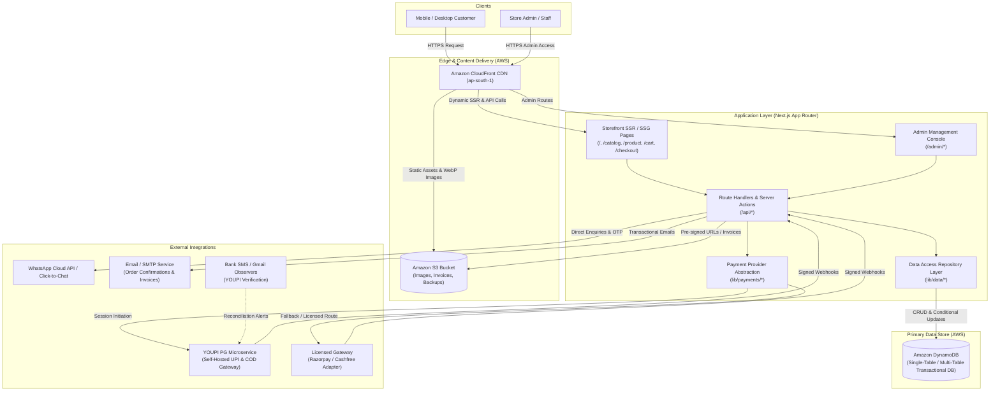
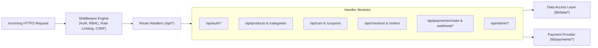
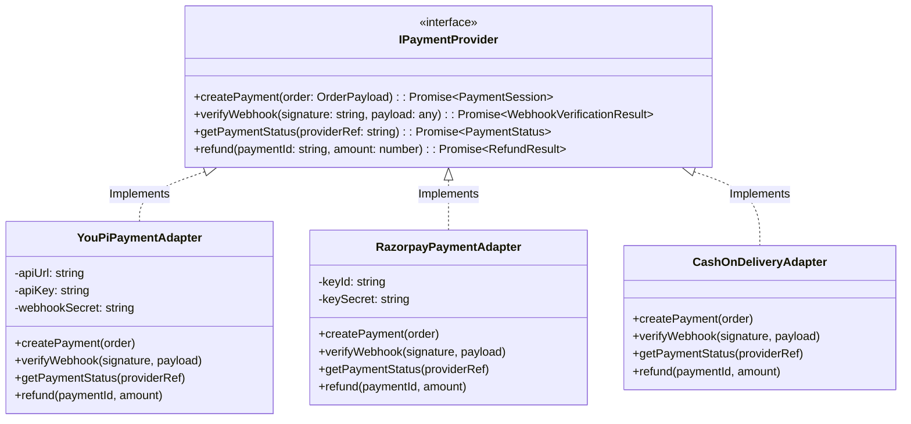
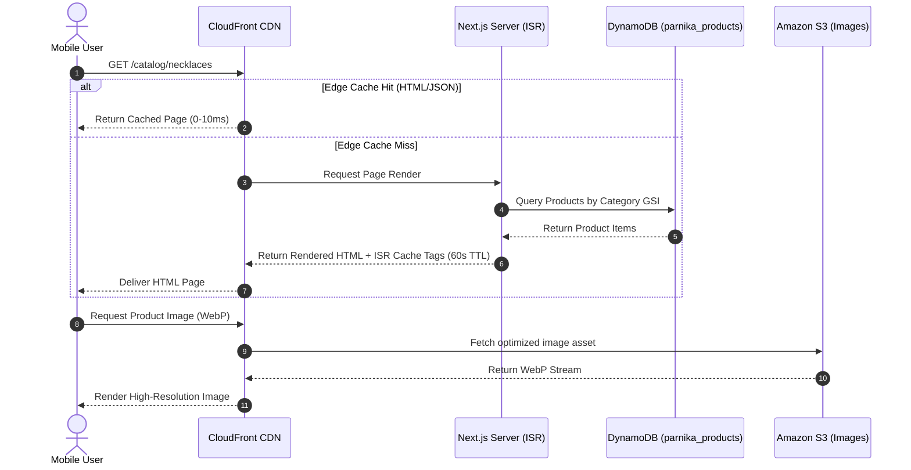
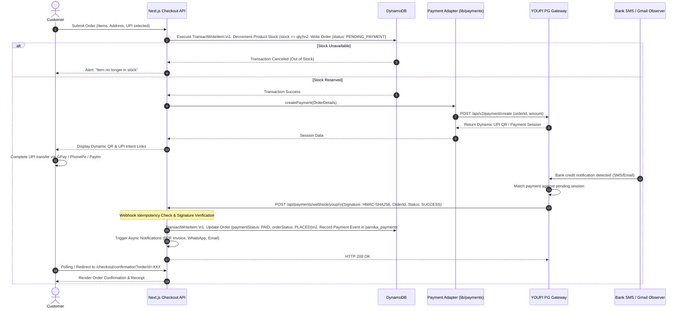
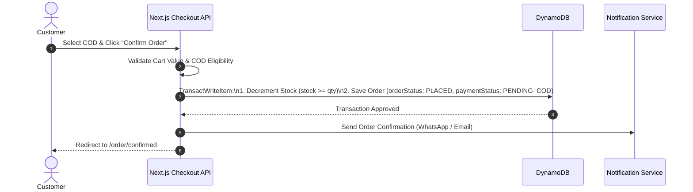
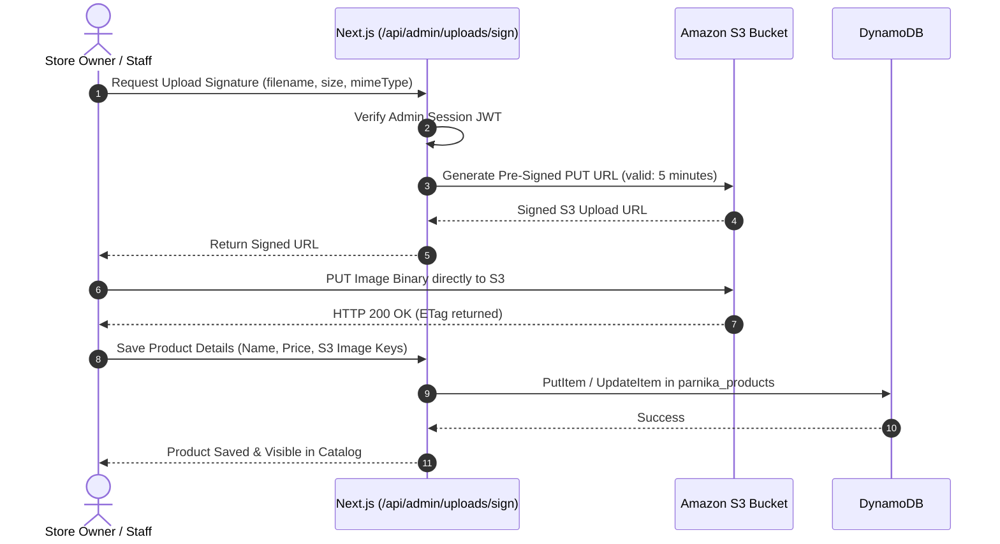
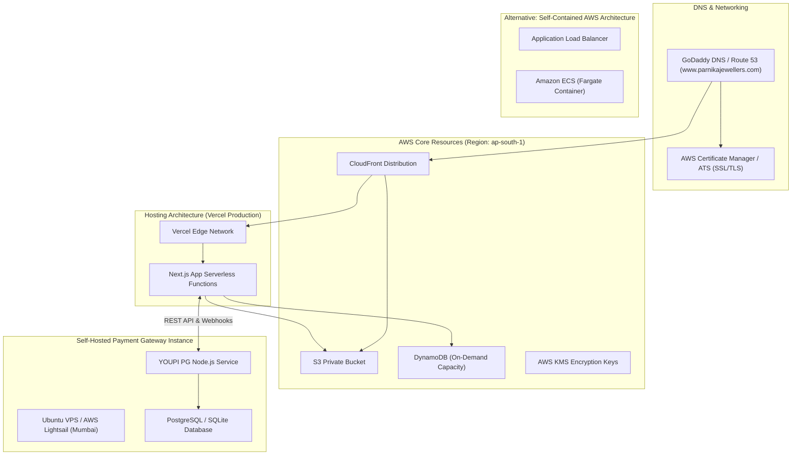

# System Architecture — Parnika Jewellers Online Store

> Reference Document: [problemstatement.md](file:///d:/PJStore%20V0/Docs/problemstatement.md)  
> Version: 1.0 (Pre-implementation / Architecture Baseline)  
> Region: `ap-south-1` (AWS Mumbai)  
> Stack: Next.js (App Router, TypeScript) • Amazon DynamoDB • Amazon S3 • Amazon CloudFront • YOUPI PG / Licensed Gateway

---

## 1. System Overview & High-Level Architecture

Parnika Jewellers operates an online e-commerce platform specializing in fashion jewellery and one-gram gold jewellery under a trading (buy-and-sell) model. The system requires high reliability, low-latency mobile-first performance, zero-oversell stock management, and self-hosted/licensed payment gateway flexibility.

The architecture combines a unified **Next.js Fullstack Web Application** (SSR/SSG/ISR storefront + authenticated `/admin` operations) with **AWS Serverless infrastructure** (DynamoDB for transactional records, S3 + CloudFront for media and backups) and isolated **Payment Gateway microservices**.



---

## 2. Frontend Architecture (Next.js App Router)

### 2.1 Route Structure & Rendering Strategy

The frontend is built with **Next.js App Router (TypeScript)** utilizing hybrid rendering (Server Components, Incremental Static Regeneration, and Client Components where interactivity is required):

```
app/
├── (storefront)/
│   ├── layout.tsx                 # Global header, nav drawer, currency/cart indicator, brand footer
│   ├── page.tsx                   # ISR: Hero banner carousel, featured categories, new arrivals, best sellers
│   ├── catalog/
│   │   ├── page.tsx               # SSR: Filterable grid (price, category, finish, occasion, in-stock)
│   │   └── [category]/page.tsx    # ISR/SSR: Category-specific landing pages
│   ├── product/
│   │   └── [slug]/page.tsx        # ISR (revalidate: 60s): Product gallery, zoom, price, specs, WhatsApp CTA
│   ├── cart/
│   │   └── page.tsx               # Client Component: Local/persistent cart, quantity updates, coupon bar
│   ├── checkout/
│   │   └── page.tsx               # Client + Server Action: Address capture, delivery mode, payment selection
│   ├── account/
│   │   ├── login/page.tsx         # OTP / Password login form
│   │   ├── orders/page.tsx        # Customer order history & tracking
│   │   └── wishlist/page.tsx      # Customer saved items
│   └── (static)/
│       ├── about/page.tsx         # SSG: Brand narrative & one-gram jewellery craftsmanship
│       ├── shipping/page.tsx      # SSG: Shipping policy & timeline
│       ├── returns/page.tsx       # SSG: Cancellation & replacement policy
│       └── privacy/page.tsx       # SSG: DPDP compliance & terms
├── admin/
│   ├── layout.tsx                 # Protected admin shell, sidebar navigation, staff profile
│   ├── page.tsx                   # Admin Dashboard: Daily sales, open orders, low-stock warnings
│   ├── inventory/
│   │   ├── page.tsx               # Product table, filtering by SKU/supplier code, stock toggles
│   │   ├── new/page.tsx           # Multi-image direct S3 uploader, variant creator, price setting
│   │   └── bulk/page.tsx          # CSV bulk catalog import
│   ├── orders/
│   │   ├── page.tsx               # Order pipeline (placed, paid, packed, shipped, delivered)
│   │   └── [id]/page.tsx          # Order inspector, packing slip generator, PDF invoice download
│   ├── coupons/
│   │   └── page.tsx               # Coupon code builder (flat/%, minimum cart value, usage caps)
│   ├── payments/
│   │   └── page.tsx               # Gateway credentials, observer status, unverified transactions
│   └── settings/
│       └── page.tsx               # Shipping tiers, tax/GST settings, WhatsApp contact numbers
└── api/                           # Backend Route Handlers
```

### 2.2 Design System, Theme Tokens & Branding

The user interface adheres to a luxury Indian aesthetic built with mobile-first CSS tokens in `styles/tokens.css`:

| Design Token | Role | Hex Value / Variable | Purpose |
|---|---|---|---|
| `--color-primary-base` | Emerald Green Base | `#0B3B24` | Primary surfaces, header backdrop, deep tone |
| `--color-primary-dark` | Deep Forest Emerald | `#062617` | Footers, high-contrast text containers |
| `--color-accent-gold` | Royal Temple Gold | `#D4AF37` | Badges, primary CTAs, borders, crest accents |
| `--color-accent-light-gold` | Champagne Gold | `#F3E5AB` | Active hovers, subtle icon outlines |
| `--color-ruby-alert` | Ruby Red | `#9B111E` | Discounts, clearance badges, low-stock alerts |
| `--color-surface-card` | Ivory Mist | `#FCFBF7` | Clean card background, neutral backdrop for jewellery |
| `--font-display` | Playfair Display / Serif | Custom | Heading, brand elegance |
| `--font-body` | Inter / Sans-serif | System | Crisp product descriptions and prices |

- **Image Backdrop Consistency:** Product images feature either transparent or neutral `#F9F8F6` backdrops with lazy loading and WebP source sets.
- **Accessibility (WCAG AA):** Gold text over dark emerald backgrounds maintains a contrast ratio exceeding 4.5:1; high-contrast outlines for interactive form inputs.

---

## 3. Backend Architecture & Service Design

### 3.1 API & Request Routing Boundary

The backend consists of **Next.js Route Handlers** running in a Node.js runtime environment:



### 3.2 Middleware & Security Layer

1. **Authentication & Session Tokens:**
   - **Customer Sessions:** Handled via stateless JWT stored in secure `httpOnly`, `SameSite=Lax`, `Secure` cookies with 30-day expiration.
   - **Admin Sessions:** Separate, short-lived (8 hours) `httpOnly` admin session token with strict HMAC verification and IP/User-Agent fingerprint validation.
2. **Role-Based Access Control (RBAC):**
   - Public paths: `/`, `/catalog`, `/product/*`, `/api/products`, `/api/categories`, `/api/payments/webhook/*`.
   - Customer paths: `/account/*`, `/api/cart`, `/api/checkout`, `/api/orders/mine`.
   - Admin paths: `/admin/*`, `/api/admin/*` (strictly restricted to `role === 'admin'`).
3. **Rate Limiting:**
   - OTP requests and login attempts capped to 5 attempts per 15 minutes per IP.
   - Coupon validation capped to 20 calls per minute to prevent code brute-forcing.
4. **Input Validation:**
   - Every route payload is validated at the boundary using **Zod** schemas before processing.

### 3.3 Data Access Layer (Repository Pattern)

To ensure zero coupling between database drivers and business logic, all database interactions execute through strict TypeScript interfaces located in `lib/data/`:

```
lib/data/
├── interfaces/
│   ├── IProductRepository.ts      # findById, findBySlug, queryCatalog, updateStockConditional
│   ├── ICategoryRepository.ts     # listCategories, getCategoryTree
│   ├── ICartRepository.ts         # getCart, saveCart, clearCart
│   ├── IOrderRepository.ts        # createOrderWithLock, updateOrderStatus, listOrders
│   ├── ICouponRepository.ts       # findByCode, incrementUsageCount
│   ├── IUserRepository.ts         # findByPhone, findByEmail, createCustomer
│   └── IPaymentRepository.ts      # recordPaymentEvent, markPaidIfUnprocessed
└── dynamodb/
    ├── client.ts                  # DynamoDBClient & DynamoDBDocumentClient singleton
    ├── ProductRepository.ts       # Implementation using DynamoDB TransactWrite/UpdateItem
    ├── OrderRepository.ts         # Implementation with conditional check expressions
    └── ...
```

---

## 4. Database & Storage Architecture

### 4.1 Amazon DynamoDB Schema

Transactional records require microsecond read latency and atomic concurrent writes. The database is organized either in a single-table layout or clean dedicated tables prefixed with `parnika_`.

```mermaid
erDiagram
    CUSTOMER ||--o{ ORDER : places
    ORDER ||--|{ ORDER_ITEM : contains
    ORDER ||--o| PAYMENT_RECORD : verified_by
    PRODUCT ||--o{ ORDER_ITEM : references
    COUPON ||--o{ ORDER : discounts
    CATEGORY ||--o{ PRODUCT : categorizes

    PRODUCT {
        string id PK
        string sku GSI_PK
        string slug GSI_PK
        string categoryId
        string name
        number price
        number mrp
        number costPrice
        number stock
        number lowStockAt
        string status
        json images
        json variants
    }

    ORDER {
        string id PK
        string orderNo GSI_PK
        string userId GSI_PK
        string orderStatus
        string paymentStatus
        number subtotal
        number discount
        number shippingFee
        number total
        json addressSnapshot
        json itemsSnapshot
        string createdAt
    }

    PAYMENT_RECORD {
        string id PK
        string orderId GSI_PK
        string provider
        string providerRef
        number amount
        string status
        string rawWebhookKey
        string verifiedAt
    }

    COUPON {
        string code PK
        string type
        number value
        number minCart
        number maxDiscount
        number usageLimit
        number usedCount
        boolean active
    }
```

#### Table Indexing and Query Patterns

| Table / Entity | Partition Key (PK) | Sort Key (SK) | Global Secondary Indexes (GSI) | Critical Query Pattern |
|---|---|---|---|---|
| **Products** (`parnika_products`) | `id` (UUID) | - | **GSI-1:** `category` + `createdAt`<br>**GSI-2:** `slug`<br>**GSI-3:** `sku` | Direct product lookup by slug; catalog browsing by category; stock lookup |
| **Orders** (`parnika_orders`) | `id` (UUID) | - | **GSI-1:** `userId` + `createdAt`<br>**GSI-2:** `orderStatus` + `createdAt`<br>**GSI-3:** `orderNo` | Customer order history; Admin fulfillment queue; Order tracking by order number |
| **Coupons** (`parnika_coupons`) | `code` (UPPERCASE) | - | - | Instant coupon validation and atomic usage increment |
| **Users** (`parnika_users`) | `id` (UUID) | - | **GSI-1:** `phone`<br>**GSI-2:** `email` | Customer login via OTP / credentials lookup |
| **Payments** (`parnika_payments`)| `id` (UUID) | - | **GSI-1:** `orderId`<br>**GSI-2:** `providerRef` | Webhook idempotency and verification audit lookup |

#### Concurrency & Zero-Oversell Atomic Update

To guarantee that two buyers cannot purchase the final item simultaneously, stock deductions rely on **DynamoDB Conditional Expressions**:

$$\text{Condition: } \mathtt{stock} \ge \mathtt{requestedQuantity} \land \mathtt{status} = \text{'ACTIVE'}$$

```typescript
// Sample DynamoDB Conditional Update Expression
const params = {
  TableName: 'parnika_products',
  Key: { id: productId },
  UpdateExpression: 'SET stock = stock - :qty, updatedAt = :now',
  ConditionExpression: 'stock >= :qty AND #st = :activeStatus',
  ExpressionAttributeNames: { '#st': 'status' },
  ExpressionAttributeValues: {
    ':qty': requestedQty,
    ':activeStatus': 'ACTIVE',
    ':now': new Date().toISOString()
  }
};
```
If the condition fails (`ConditionalCheckFailedException`), the checkout aborts immediately with a user-facing out-of-stock message, avoiding inventory discrepancy.

### 4.2 S3 Bucket Structure & Dedicated Instance Isolation

> **CRITICAL AWS MULTI-PROJECT ISOLATION GUARANTEE:**  
> The AWS account hosting this application may contain other independent projects and buckets. To guarantee zero disruption or cross-talk with existing projects:
> 1. **Dedicated S3 Bucket Instance:** All assets, invoices, and backups for this store are strictly isolated in a dedicated project bucket: `parnika-jewellers-v0-<env>` (e.g. `parnika-jewellers-v0-prod`). No existing buckets are ever accessed, read, listed, or mutated.
> 2. **Dedicated Scoped IAM Policy:** The IAM credentials (`AWS_ACCESS_KEY_ID` / `AWS_SECRET_ACCESS_KEY`) assigned to this application MUST be constrained via a resource-level IAM policy. Wildcard `Resource: "*"` is prohibited. Actions are restricted solely to `arn:aws:s3:::parnika-jewellers-v0-*` and `arn:aws:dynamodb:ap-south-1:*:table/parnika_*`.

```
parnika-jewellers-v0-prod/
├── products/
│   └── <productId>/
│       ├── <uuid>-original.jpg      # Uploaded master
│       ├── <uuid>-large.webp         # 1200x1200 zoom view
│       ├── <uuid>-medium.webp        # 600x600 catalog card
│       └── <uuid>-thumb.webp         # 150x150 cart/thumbnail
├── banners/
│   ├── hero-desktop-<uuid>.webp
│   └── hero-mobile-<uuid>.webp
├── brand/
│   ├── logo.svg
│   ├── crest-motif.svg
│   └── favicon.ico
├── invoices/
│   └── INV-<orderNo>.pdf            # Generated on order completion
└── backups/
    └── <YYYY-MM-DD>/
        ├── products.json.gz
        ├── orders.json.gz
        └── coupons.json.gz
```

- **CloudFront Integration:** S3 is completely private (`BlockPublicAcls = true`, `BlockPublicPolicy = true`). Assets are accessed exclusively through an AWS CloudFront Origin Access Control (OAC) distribution dedicated to this bucket.
- **Admin Upload Pipeline:** The browser requests a pre-signed PUT URL from `/api/admin/uploads/sign`, uploads directly to S3 with cryptographic MD5 checks, and an internal serverless handler or background step handles WebP conversion.

#### Dedicated Project IAM Policy Specification

```json
{
  "Version": "2012-10-17",
  "Statement": [
    {
      "Sid": "IsolatedS3AccessForParnika",
      "Effect": "Allow",
      "Action": [
        "s3:PutObject",
        "s3:GetObject",
        "s3:DeleteObject",
        "s3:ListBucket"
      ],
      "Resource": [
        "arn:aws:s3:::parnika-jewellers-v0-*",
        "arn:aws:s3:::parnika-jewellers-v0-*/*"
      ]
    },
    {
      "Sid": "IsolatedDynamoDBAccessForParnika",
      "Effect": "Allow",
      "Action": [
        "dynamodb:PutItem",
        "dynamodb:GetItem",
        "dynamodb:UpdateItem",
        "dynamodb:DeleteItem",
        "dynamodb:Query",
        "dynamodb:Scan",
        "dynamodb:BatchWriteItem",
        "dynamodb:BatchGetItem"
      ],
      "Resource": [
        "arn:aws:dynamodb:ap-south-1:*:table/parnika_*",
        "arn:aws:dynamodb:ap-south-1:*:table/parnika_*/index/*"
      ]
    }
  ]
}
```

---

## 5. Third-Party Integrations & Payment Abstraction

### 5.1 Payment Provider Architecture (`lib/payments/`)

Because YOUPI PG is an experimental, non-banking-certified gateway, the system isolates payments behind a modular adapter interface:



- **Primary Gateway:** `YouPiPaymentAdapter` communicates with the self-hosted YOUPI PG instance via REST endpoints.
- **Fallback / Alternative Gateway:** `RazorpayPaymentAdapter` or `CashfreePaymentAdapter` handles credit/debit cards, net banking, and certified UPI.
- **Switching Mechanism:** Regulated via the `PAYMENT_PROVIDER` environment variable or dynamic runtime setting stored in DynamoDB `parnika_settings`.

### 5.2 External Notification Services

1. **WhatsApp Messaging:**
   - **Click-to-Chat:** Direct floating button with URL encoding: `https://wa.me/<number>?text=Hi%20Parnika%20Jewellers,%20I%20am%20interested%20in%20...`
   - **Automated Alerts:** Order confirmation and tracking updates sent via WhatsApp Cloud API or SMS gateway.
2. **Transactional Email (SMTP / AWS SES):**
   - Dispatches HTML order receipts and attaches generated PDF invoices upon payment verification.

---

## 6. Key Data Flows

### 6.1 Catalog Browsing & Caching Flow



---

### 6.2 Checkout & Online Payment Flow (YOUPI PG / Gateway)



---

### 6.3 Cash on Delivery (COD) Flow



---

### 6.4 Admin Media Upload Flow



---

## 7. Security, Reliability & Compliance Architecture

### 7.1 Security & Fraud Prevention
- **No Cardholder Data Stored:** Credit card details, CVVs, and UPI PINs are never accepted or parsed by the Next.js server; all sensitive inputs are tokenized directly within the gateway.
- **Webhook Replay Protection & Idempotency:**
  Every incoming webhook is verified with an HMAC-SHA256 signature using `YOUPI_WEBHOOK_SECRET` or the licensed provider secret. Every webhook event ID is recorded in `parnika_payments` with a unique constraint. If an event ID already exists, the server responds with `HTTP 200` without re-processing order state.
- **Zero-Trust Admin Protection:**
  - Passwords hashed with `Argon2id` or `bcrypt` (cost factor 12).
  - Admin endpoints verify session tokens, user role, and HTTP headers on every invocation.
  - Comprehensive Audit Trail recorded in `parnika_audit_logs` tracking price modifications, coupon creation, and manual order overrides.

### 7.2 Regulatory & Legal Compliance (India)
- **Digital Personal Data Protection Act (DPDP):** Customer phone numbers, addresses, and purchase history are stored encrypted at rest with AWS KMS. Clear opt-in consent captured at checkout.
- **Hallmark & Jewellery Representation:** Product schema explicitly distinguishes between *One-Gram Gold Plated Fashion Jewellery* and *Precious Metals* to prevent misleading customer claims.
- **GST-Compliant Invoicing:** Generated invoices feature registered GSTIN, HSN codes (e.g., 7117 for imitation jewellery), clear tax breakdowns (CGST + SGST or IGST), and sequential invoice numbers.

### 7.3 Disaster Recovery & Backup Strategy
- **Nightly Snapshot Pipeline:** A scheduled AWS EventBridge / Cron task dumps all DynamoDB tables to compressed JSON files stored in `s3://parnika-store-prod/backups/<YYYY-MM-DD>/`.
- **S3 Versioning & Lifecycle:** Media buckets use S3 Object Versioning to prevent accidental deletions, transitioning older original uploads to S3 Standard-Infrequent Access after 90 days.

---

## 8. Infrastructure & Deployment Topography



### Environment Variable Contract

```bash
# AWS Infrastructure (ap-south-1 Mumbai)
AWS_REGION=ap-south-1
AWS_ACCESS_KEY_ID=AKIA...
AWS_SECRET_ACCESS_KEY=...
DYNAMO_TABLE_PREFIX=parnika_
S3_BUCKET_NAME=parnika-jewellers-v0-prod
CLOUDFRONT_DISTRIBUTION_DOMAIN=assets.parnikajewellers.com

# Auth & Secrets
JWT_SECRET=super-secure-random-token-64-chars
ADMIN_BOOTSTRAP_EMAIL=admin@parnikajewellers.com
ADMIN_BOOTSTRAP_PASSWORD=...

# Payment Gateway Configuration
PAYMENT_PROVIDER=youpi            # youpi | razorpay | cashfree
YOUPI_BASE_API_URL=https://pg.parnikajewellers.com
YOUPI_API_KEY=...
YOUPI_WEBHOOK_SECRET=...

# Fallback Gateway Credentials (Stubbed)
RAZORPAY_KEY_ID=
RAZORPAY_KEY_SECRET=

# External Services
WHATSAPP_PHONE_NUMBER_ID=
WHATSAPP_ACCESS_TOKEN=
SMTP_HOST=email-smtp.ap-south-1.amazonaws.com
SMTP_PORT=587
SMTP_USER=...
SMTP_PASS=...
NEXT_PUBLIC_STORE_URL=https://www.parnikajewellers.com
```

---

## 9. Architecture Decision Records (ADRs)

| ID | Title | Status | Decision | Consequence |
|---|---|---|---|---|
| **ADR-01** | Unified Fullstack Next.js | Accepted | Use Next.js App Router for both storefront and admin panel rather than two separate repos. | Single build pipeline, shared TypeScript types across models and API, simplified deployment. |
| **ADR-02** | DynamoDB for Transactional Store | Accepted | Use DynamoDB with conditional expressions instead of S3-only data storage. | Prevents overselling with atomic conditional updates (`stock >= qty`), offers sub-10ms queries, scales effortlessly on demand. |
| **ADR-03** | Decoupled PaymentProvider Interface | Accepted | Abstract payments behind an adapter interface; implement YOUPI PG first while stubbing Razorpay/Cashfree. | Protects the business against YOUPI PG downtime or compliance issues; allows switching gateways with zero changes to checkout logic. |
| **ADR-04** | Direct S3 Client Uploads | Accepted | Admin uploads images directly to S3 via pre-signed URLs rather than streaming large files through Next.js server. | Avoids Next.js server memory spikes and serverless timeout limits; enables rapid multi-image product listings. |
| **ADR-05** | CloudFront Private Bucket OAC | Accepted | Block all direct public access to S3; route all public assets through CloudFront with Origin Access Control. | Enhanced security, zero egress costs between S3 and CloudFront, global low latency for mobile customers. |
| **ADR-06** | Dedicated AWS Resource Isolation | Accepted | Deploy a dedicated S3 bucket (`parnika-jewellers-v0-<env>`) and scope IAM policies strictly to `parnika-jewellers-v0-*` and `parnika_*`. | Completely prevents touching, scanning, or disturbing any other existing projects, buckets, or tables in the user's AWS account. |

