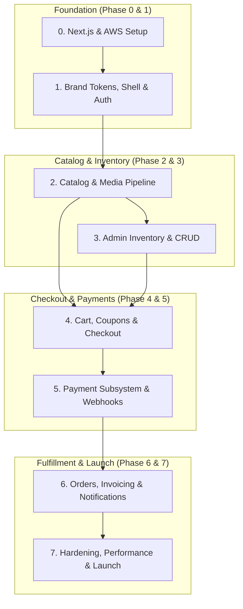

# Implementation Plan — Parnika Jewellers Online Store

> Reference Specifications:
> - [problemstatement.md](file:///d:/PJStore%20V0/Docs/problemstatement.md)
> - [architecture.md](file:///d:/PJStore%20V0/Docs/architecture.md)
>
> **Target Platform:** Next.js (App Router, TypeScript) • Amazon DynamoDB • Amazon S3 • Amazon CloudFront • YOUPI PG / Licensed Gateway  
> **AWS Region:** `ap-south-1` (Mumbai)  
> **Status:** Ready for Execution

---

## 1. Executive Summary & Execution Strategy

This implementation plan translates the product requirements and technical architecture into a sequence of seven actionable phases. Each phase defines concrete tasks, code contracts, deliverables, verification criteria, and dependency checkpoints.

### Key Architectural Tenets Enforced Throughout Execution
1. **Repository Abstraction:** All data operations are routed through `lib/data/` interfaces, keeping DynamoDB decoupled from UI components and API handlers.
2. **Zero-Oversell Guarantee:** Every inventory decrement executes via DynamoDB conditional updates (`stock >= :qty`) to prevent overselling during concurrent checkouts.
3. **Pluggable Payments:** All payment flows interface with a unified `IPaymentProvider` contract. YOUPI PG is implemented first, with Razorpay/Cashfree stubbed alongside for immediate switchover.
4. **Direct Media Pipeline:** Admin image uploads bypass the Node.js application server using short-lived S3 pre-signed PUT URLs.
5. **Mobile-First & Performance:** Target Lighthouse Mobile Score $\ge 85$ across core catalog and product routes.
6. **Strict AWS Resource Isolation:** Dedicated bucket instance (`parnika-jewellers-v0-<env>`) and scoped IAM policies restricted strictly to `parnika-jewellers-v0-*` and `parnika_*` ARNs, guaranteeing existing projects in the user's AWS account are never read, modified, or disturbed.

---

## 2. Phase-Wise Roadmap Overview


| Phase | Milestone | Estimated Effort | Core Focus |
|---|---|---|---|
| **Phase 0** | Foundation & Cloud Infrastructure | Day 1–2 | Next.js setup, AWS resources (DynamoDB, S3, CloudFront), data layer interfaces |
| **Phase 1** | Brand System, Shell & Auth | Day 3–4 | Emerald/gold/ruby design tokens, responsive layout, customer & admin authentication |
| **Phase 2** | Catalog Browsing & Media Pipeline | Day 5–7 | S3 image pipeline, category pages, product detail page (PDP), WhatsApp CTA |
| **Phase 3** | Admin Inventory & Catalog Management | Day 8–10 | Product CRUD, S3 direct upload, bulk CSV import, low-stock monitoring |
| **Phase 4** | Cart, Coupon Engine & Checkout Flow | Day 11–13 | Persistent cart, conditional coupon logic, atomic stock reservation checkout |
| **Phase 5** | Payment Gateway Subsystem | Day 14–16 | YOUPI PG adapter, dynamic UPI QR, webhook verification, Cash on Delivery (COD) |
| **Phase 6** | Order Lifecycle, Invoicing & Comms | Day 17–19 | Order tracking, GST PDF invoices, WhatsApp/Email notifications, admin order queue |
| **Phase 7** | Hardening, Performance & Launch | Day 20–22 | Concurrency testing, Lighthouse mobile audit, DPDP compliance, backups & cutover |

---

## 3. Detailed Phase Breakdown

---

### Phase 0: Foundation & Infrastructure Provisioning

#### Objective
Initialize the repository workspace, configure the TypeScript Next.js App Router project, set up AWS DynamoDB and S3 resources in `ap-south-1`, establish data access layer contracts, and implement database bootstrap scripts.

#### Deliverables & Tasks
- [x] **0.1 Project Initialization:**
  - Initialize Next.js 14/15 with TypeScript, Tailwind CSS, ESLint, and Prettier.
  - Establish base directory structure per [architecture.md](file:///d:/PJStore%20V0/Docs/architecture.md#21-route-structure--rendering-strategy).
  - Configure environment variable schema and validator using `zod` (`lib/env.ts`).
- [x] **0.2 AWS Infrastructure Setup & Resource Isolation (`ap-south-1`):**
  - Create dedicated S3 Bucket `parnika-jewellers-v0-<env>` with Block All Public Access enabled.
  - Ensure zero interference with other buckets in the AWS account: verify scoped IAM policy restricts access strictly to `arn:aws:s3:::parnika-jewellers-v0-*` and `arn:aws:dynamodb:ap-south-1:*:table/parnika_*`.
  - Configure dedicated CloudFront distribution with Origin Access Control (OAC) targeting only this S3 bucket.
  - Provision Amazon DynamoDB tables (On-Demand capacity) with table prefix `parnika_`:
    - `parnika_products` (PK: `id`, GSIs: `slug`, `category-createdAt`, `sku`)
    - `parnika_categories` (PK: `id`, GSI: `slug`)
    - `parnika_orders` (PK: `id`, GSIs: `orderNo`, `userId-createdAt`, `orderStatus-createdAt`)
    - `parnika_users` (PK: `id`, GSIs: `phone`, `email`)
    - `parnika_coupons` (PK: `code`)
    - `parnika_payments` (PK: `id`, GSIs: `orderId`, `providerRef`)
    - `parnika_settings` (PK: `key`)
    - `parnika_audit_logs` (PK: `id`, GSI: `entityId-timestamp`)
- [x] **0.3 Data Access Layer Abstraction:**
  - Build DynamoDB singleton client with `@aws-sdk/client-dynamodb` and `@aws-sdk/lib-dynamodb`.
  - Author repository interfaces in `lib/data/interfaces/`:
    - `IProductRepository`, `ICategoryRepository`, `IOrderRepository`, `IUserRepository`, `ICouponRepository`, `IPaymentRepository`.
  - Author DynamoDB repository implementations in `lib/data/dynamodb/`.
- [x] **0.4 Database Provisioning & Seed Scripts:**
  - `scripts/setup-dynamo.ts`: Programmatically creates all tables and GSIs with required attribute definitions.
  - `scripts/seed.ts`: Seeds initial categories (Fashion Jewellery, One Gram Gold, Necklaces, Earrings, Bangles, Rings, Bridal Sets) and sample jewellery items.

#### Verification & Exit Criteria
- `npm run setup:dynamo` completes and verifies all 8 tables are in `ACTIVE` state.
- `npm run seed` populates test data successfully.
- Unit tests verify `ProductRepository.findById` and `CategoryRepository.listCategories` against DynamoDB Local or AWS Test environment.

---

### Phase 1: Brand System, Layout & Authentication

#### Objective
Implement the visual identity derived from the brand logo, create responsive layout shells (storefront and admin), and configure authentication for both customers and store administrators.

#### Deliverables & Tasks
- [x] **1.1 Design System & Brand Styling:**
  - Create `styles/tokens.css` with exact brand hex variables:
    - Primary Emerald: `#0B3B24` (surfaces, header, accents)
    - Deep Emerald: `#062617` (footers, dark backgrounds)
    - Royal Temple Gold: `#D4AF37` (CTAs, borders, crest highlights)
    - Champagne Gold: `#F3E5AB` (hover states, subtle icons)
    - Ruby Red: `#9B111E` (badges, sale highlights, alerts)
    - Neutral Ivory: `#FCFBF7` (product backdrop and card surfaces)
  - Process `Final Logo.jpeg` into `/public/brand/logo.png` and extract crest favicon `/public/favicon.ico`.
  - Configure Tailwind theme extensions in `tailwind.config.ts` mapping to these tokens.
- [x] **1.2 Storefront & Admin Layout Shells:**
  - Storefront layout (`app/(storefront)/layout.tsx`):
    - Header with logo, mobile search bar, category navigation menu, cart icon with badge, WhatsApp quick link.
    - Responsive mobile navigation drawer for phones (portrait/landscape).
    - Footer with brand mission, trust badges ("1-Gram Gold Certified", "Safe Delivery"), customer care, policy links.
  - Admin layout (`app/admin/layout.tsx`):
    - Collapsible sidebar with navigation items: Dashboard, Inventory, Orders, Coupons, Payments, Customers, Settings.
    - Admin header with staff identifier, quick store link, and logout action.
- [x] **1.3 Customer Authentication (`/account/login`, `/api/auth/*`):**
  - Implement phone/email OTP and password login paths.
  - Store session credentials in stateless `httpOnly`, `Secure`, `SameSite=Lax` JWT cookies (30-day expiry).
  - Provide session hook `useAuth()` and server helper `getCurrentUser()`.
- [x] **1.4 Admin Authentication & RBAC (`/admin/login`, `/api/admin/auth/*`):**
  - Seed bootstrap admin via environment variables (`ADMIN_BOOTSTRAP_EMAIL`, `ADMIN_BOOTSTRAP_PASSWORD`).
  - Hash passwords using `bcrypt` (12 rounds) or `argon2id`.
  - Issue distinct `admin_session` token (8-hour expiry).
  - Next.js middleware protection (`middleware.ts`) enforcing admin role verification on all `/admin/*` and `/api/admin/*` routes.

#### Verification & Exit Criteria
- Lighthouse accessibility check confirms color contrast meets WCAG AA ($> 4.5:1$ for body and gold accents).
- Admin routes reject unauthenticated requests and redirect to `/admin/login`.
- Non-admin authenticated customers attempting to access `/admin` receive an HTTP 403 Forbidden.

---

### Phase 2: Product Catalog & Media Pipeline

#### Objective
Build the customer-facing browsing experience, search and filtering systems, product details page with image zoom, and S3 pre-signed upload pipelines.

#### Deliverables & Tasks
- [x] **2.1 S3 Media Pipeline:**
  - Implement `/api/admin/uploads/sign` route handler to generate short-lived pre-signed PUT URLs with file size ($\le 10\text{MB}$) and MIME type (`image/jpeg`, `image/png`, `image/webp`) restrictions.
  - Implement client-side direct upload component with upload progress indicator.
  - Image serving strategy: CloudFront CDN URL generation (`https://assets.parnikajewellers.com/products/<productId>/<file>.webp`).
- [x] **2.2 Catalog Browsing & Filtering (`/catalog`, `/catalog/[category]`):**
  - Implement Server-Side Rendered (SSR) / Incremental Static Regeneration (ISR) catalog pages.
  - Multi-faceted filter system:
    - Category selection (Fashion Jewellery, One Gram Gold, Necklaces, etc.)
    - Price range slider / checkboxes
    - Material / Finish (Matte Gold, Antique Gold, Glossy, CZ Stone, Ruby Inlay)
    - Occasion (Bridal, Festive, Daily Wear)
    - Stock status filter ("In Stock Only")
  - Sort options: Price Low-to-High, Price High-to-Low, Newest Arrivals, Best Sellers.
- [x] **2.3 Product Detail Page (PDP) (`/product/[slug]`):**
  - Image gallery with thumbnail carousel and desktop hover zoom.
  - Dynamic pricing box showing Selling Price, MRP (with strike-through), and percentage discount badge.
  - Product specifications table (Product Code, Material, Polish Warranty, Plating, Care instructions).
  - Sticky mobile action bar: "Add to Cart", "Buy Now", and "Enquire on WhatsApp".
  - Prefilled WhatsApp enquiry button linking to `https://wa.me/<number>?text=...` with product name, SKU, price, and current URL.
  - Open Graph tags and JSON-LD structured data (`schema.org/Product`) for search indexing.

#### Verification & Exit Criteria
- Product pages revalidate via ISR within 60 seconds upon admin updates.
- Clicking "Enquire on WhatsApp" opens WhatsApp with the exact pre-filled product details.
- Structured Data testing tool validates `Product` schema with zero errors.

---

### Phase 3: Admin Inventory & Catalog Management

#### Objective
Equip the store owner with a management panel to manage stock, edit prices, upload product imagery directly to S3, and perform bulk CSV imports without developer intervention.

#### Deliverables & Tasks
- [x] **3.1 Inventory Dashboard (`/admin/inventory`):**
  - Data table displaying: Image, Product Name, SKU, Supplier Code (e.g. `DBI-102`), Selling Price, Cost Price, Stock Count, Status toggle (Active/Draft/Archived).
  - Low-stock badge highlighting items where $\mathtt{stock} \le \mathtt{lowStockAt}$.
  - Search by product title, SKU, or supplier code; filter by category and stock level.
- [x] **3.2 Product Editor (`/admin/inventory/new`, `/admin/inventory/[id]`):**
  - Multi-image drag-and-drop uploader streaming directly to S3 via pre-signed URLs.
  - Drag-to-reorder product gallery images; set primary thumbnail.
  - Form inputs for:
    - Basic Info: Title, Slug (auto-generated with manual override), Category, Tags, Description.
    - Pricing: Selling Price, MRP, Cost Price (for admin margin calculation).
    - Inventory: SKU, Supplier Code, Initial Stock, Low-Stock Threshold.
    - Jewellery Specs: Finish, Base Metal, Weight, Stone Type, Dimensions.
    - Zod validation schema on client and server to prevent invalid data formats.
- [x] **3.3 Bulk Catalog CSV Import (`/admin/inventory/bulk`):**
  - Downloadable CSV template with standard headers (`title`, `sku`, `supplierCode`, `category`, `price`, `mrp`, `costPrice`, `stock`, `imageUrls`, `description`).
  - File upload parser validating rows, generating SKUs if missing, and batching writes via DynamoDB `BatchWriteItem`.
  - Detailed error reporting modal displaying failed rows and validation reasons.
- [x] **3.4 Audit Trail Integration:**
  - Write all product additions, price adjustments, and stock edits to `parnika_audit_logs`.

#### Verification & Exit Criteria
- Admin can upload 5 product images concurrently, with files arriving directly in S3 and URLs saved in DynamoDB.
- CSV import of 50 products executes with all items appearing immediately in the catalog.
- Price modification immediately reflects on the storefront while logging the staff identity in audit logs.

---

### Phase 4: Cart, Coupon Engine & Checkout Flow

#### Objective
Implement an e-commerce shopping cart, discount coupon engine, and checkout pipeline with atomic stock deduction to prevent overselling.

#### Deliverables & Tasks
- [x] **4.1 Shopping Cart Subsystem (`/cart`, `app/context/CartContext.tsx`):**
  - Persistent cart: LocalStorage for guest users, synchronized to DynamoDB `parnika_carts` on login.
  - Cart drawer and dedicated `/cart` page with line items, quantity increment/decrement, item removal.
  - Real-time stock validation: Display alert if item in cart exceeds current available inventory.
  - Price summary component: Subtotal, Discount, Shipping charges (free shipping threshold logic), Estimated Total.
- [x] **4.2 Coupon & Promotion Engine (`lib/data/CouponRepository.ts`, `/api/coupons/*`):**
  - Coupon validation endpoint verifying:
    - `active === true`
    - Current date within `validFrom` and `validTo`
    - Cart subtotal $\ge \mathtt{minCart}$
    - `usedCount < usageLimit` (global limit)
    - Customer usage count $< \mathtt{perUserLimit}$
  - Discount calculation: Flat amount or percentage with $\mathtt{maxDiscount}$ cap.
  - Admin coupon manager (`/admin/coupons`): Create, expire, and track coupon usage.
- [x] **4.3 Checkout Flow (`/checkout`):**
  - Step 1: Customer details & shipping address (saved address selector for logged-in users).
  - Step 2: Shipping method selection (Standard Delivery / Express Delivery).
  - Step 3: Payment method selection:
    - Dynamic UPI / Online Payment (YOUPI PG / Gateway)
    - Cash on Delivery (COD)
  - Step 4: Order review and price breakdown.
- [x] **4.4 Concurrency Control & Atomic Stock Deduction:**
  - Implement DynamoDB `TransactWriteItems` inside `OrderRepository.createOrderWithLock()`:
    1. Condition check and stock decrement for each line item:
       $$\mathtt{ConditionExpression} = \text{"stock >= :qty AND #status = :active"}$$
    2. Atomic increment of coupon `usedCount` (if coupon applied).
    3. Put new Order record with status `PENDING_PAYMENT` (or `PLACED` for COD).
  - If transaction cancels due to `ConditionalCheckFailed`, return structured error: `"One or more items in your cart just sold out"`.

#### Verification & Exit Criteria
- Concurrency test: Two parallel checkout requests for a product with 1 unit in stock result in exactly 1 successful order and 1 out-of-stock rejection.
- Coupon usage rules enforce all boundary limits (minimum cart value, max cap, expiration).

---

### Phase 5: Payment Gateway Subsystem & Webhooks

#### Objective
Implement the payment abstraction layer, integrate the self-hosted YOUPI PG (V2) gateway for dynamic UPI payments, construct secure webhook handlers with idempotency, and stub a licensed gateway (Razorpay) as a fallback.

#### Deliverables & Tasks
- [x] **5.1 Payment Provider Interface (`lib/payments/`):**
  - Define `IPaymentProvider` contract:
    ```typescript
    export interface IPaymentProvider {
      createPayment(order: Order): Promise<PaymentSessionResult>;
      verifyWebhook(signature: string, rawBody: string): Promise<WebhookVerificationResult>;
      getPaymentStatus(providerRef: string): Promise<PaymentStatus>;
      refund(paymentId: string, amount: number): Promise<RefundResult>;
    }
    ```
- [x] **5.2 YOUPI PG Gateway Adapter (`lib/payments/youpi.ts`):**
  - REST client communicating with YOUPI PG microservice (`YOUPI_BASE_API_URL`).
  - Request payment session: Send order number, amount in paise, customer phone, return callback URL.
  - Receive session tokens and dynamic UPI QR string for on-screen customer display.
- [x] **5.3 Cash on Delivery (COD) Adapter (`lib/payments/cod.ts`):**
  - Immediately transitions order to `paymentStatus: PENDING_COD` and `orderStatus: PLACED`.
  - Verifies COD eligibility rules (e.g. cart total $\le \text{₹10,000}$).
- [x] **5.4 Licensed Gateway Fallback (`lib/payments/razorpay.ts`):**
  - Stubbed / functional Razorpay adapter implementing `IPaymentProvider` for credit/debit card, net banking, and verified UPI processing.
  - Gateway selection switch via `PAYMENT_PROVIDER` environment variable.
- [x] **5.5 Payment Webhook Handler (`/api/payments/webhook/[provider]`):**
  - Signature validation: Verify HMAC-SHA256 signature against `YOUPI_WEBHOOK_SECRET` before parsing payload.
  - Idempotency guard:
    - Check if `providerRef` exists in `parnika_payments`.
    - If already processed, return `HTTP 200 OK` immediately without repeating state mutations.
  - State update:
    - Execute `TransactWriteItem` updating order to `paymentStatus: PAID`, `orderStatus: PLACED`.
    - Record full webhook event and timestamp in `parnika_payments`.
- [x] **5.6 Admin Payment Reconciliation Dashboard (`/admin/payments`):**
  - Live status indicators for YOUPI PG observer services (Bank SMS / Gmail monitors).
  - Unmatched payments table with manual reconciliation action ("Mark as Verified").

#### Verification & Exit Criteria
- Order transitions to `PAID` exclusively via server-side webhook, never via client redirect.
- Replaying the identical webhook payload returns `HTTP 200` without duplicating order state changes.
- Setting `PAYMENT_PROVIDER=razorpay` routes checkout to Razorpay without altering frontend checkout code.

---

### Phase 6: Order Fulfillment, Customer Account & Communications

#### Objective
Build the order lifecycle pipeline, generate GST-compliant PDF invoices, enable customer order tracking, and dispatch automated WhatsApp and Email notifications.

#### Deliverables & Tasks
- [x] **6.1 Order Lifecycle Management (`/admin/orders`):**
  - Order status workflow:
    $$\text{PLACED} \longrightarrow \text{PAID} \longrightarrow \text{PACKED} \longrightarrow \text{SHIPPED} \longrightarrow \text{DELIVERED}$$
    (with branch paths for $\text{CANCELLED}$ and $\text{REFUNDED}$).
  - Admin order detail view: Item snapshots, address, payment method, courier provider, tracking number input.
  - Printable packing slip with SKU barcodes/supplier codes for store packing staff.
- [x] **6.2 GST-Compliant PDF Invoice Generator:**
  - Implement PDF generation pipeline (`lib/invoices/generator.ts`) using PDFKit or `@react-pdf/renderer`.
  - Invoice specification:
    - Store GSTIN, legal business name, registered address.
    - Customer billing and shipping address.
    - Consecutive Invoice Number (`INV-YYYY-XXXXX`).
    - HSN Code (7117 for imitation/one-gram jewellery).
    - Clear tax breakdown: CGST (1.5%) + SGST (1.5%) for intra-state, or IGST (3%) for inter-state.
  - Save generated PDF to S3 `invoices/INV-<orderNo>.pdf` and provide authenticated download link.
- [x] **6.3 Customer Account & Order Tracking (`/account/orders`):**
  - Customer order history with timeline visualization (Order Placed $\rightarrow$ Dispatched $\rightarrow$ Out for Delivery $\rightarrow$ Delivered).
  - Direct tracking link to courier partner (Delhivery/Shiprocket/India Post).
  - Re-order action (adds current in-stock items back to cart).
  - Wishlist management (`/account/wishlist`).
- [x] **6.4 Customer Notification Dispatchers:**
  - Transactional Email (`lib/notifications/email.ts`):
    - Order confirmation email with attached PDF invoice via Amazon SES / SMTP.
    - Shipping dispatch notification with tracking URL.
  - WhatsApp Notifications (`lib/notifications/whatsapp.ts`):
    - Automated confirmation message using WhatsApp Cloud API template.
    - Fallback: Pre-formatted WhatsApp share link for store owner to manually notify customer in one click.

#### Verification & Exit Criteria
- Admin updating status to `SHIPPED` with tracking number triggers email and WhatsApp alerts to customer.
- Generated PDF invoice matches all Indian GST invoicing guidelines and displays accurate HSN 7117 tax calculations.

---

### Phase 7: Hardening, Performance, Security & Production Launch

#### Objective
Execute comprehensive load and concurrency tests, conduct security audits, achieve target Lighthouse scores, implement automated disaster recovery, and perform production cutover.

#### Deliverables & Tasks
- [x] **7.1 Concurrency & Stress Testing:**
  - Execute automated stress test script (`scripts/load-test-stock.ts`) simulating 20 concurrent shoppers competing for 2 stock units.
  - Verify that stock never drops below 0 and that DynamoDB transactions handle race conditions cleanly.
- [x] **7.2 Performance & Core Web Vitals Optimization:**
  - Audit and tune Lighthouse metrics on Mobile:
    - Largest Contentful Paint (LCP) $\le 2.5\text{s}$
    - First Input Delay (FID) / Interaction to Next Paint (INP) $\le 200\text{ms}$
    - Cumulative Layout Shift (CLS) $\le 0.1$
  - Verify CloudFront caching headers on static assets and product image WebP variants.
  - Configure Next.js font optimization for display and body fonts.
- [x] **7.3 Security Hardening & DPDP Compliance:**
  - Run OWASP security checklist: Verify input sanitization, CSRF token handling, and Content Security Policy (CSP) headers.
  - Ensure all database fields with sensitive customer data (passwords, phone numbers, addresses) are encrypted at rest using AWS KMS.
  - Provide customer privacy controls and data deletion request workflow compliant with India DPDP Act.
- [x] **7.4 Disaster Recovery & Backup Automation:**
  - Deploy AWS EventBridge scheduled rule triggering nightly backup script (`scripts/backup-tables.ts`).
  - Export all DynamoDB tables to compressed JSON snapshots in `s3://parnika-jewellers-v0-prod/backups/<date>/`.
- [x] **7.5 Production Cutover & Domain Mapping:**
  - Configure custom domain (`www.parnikajewellers.com`) on GoDaddy connected to AWS Amplify with SSL certificate issued via Amazon Trust Services.
  - Configure production environment variables and deploy Next.js application to target production hosting.
  - Execute smoke tests on live domain: Category navigation, cart operations, test UPI payment, webhook delivery, admin login.

#### Verification & Exit Criteria
- Mobile Lighthouse score $\ge 85$ on homepage and product detail pages.
- Zero security vulnerabilities detected via `npm audit` and static analysis tools.
- Nightly backup script successfully generates snapshot in S3.
- End-to-end live transaction verified from mobile checkout to payment settlement.

---

## 4. Dependencies, Workflows & Critical Path



### Critical Path Analysis
1. **`lib/data/` interfaces (Phase 0)** must precede catalog browsing (Phase 2) and cart logic (Phase 4).
2. **S3 Pre-signed Upload API (Phase 2)** must be established before Admin Inventory UI (Phase 3) can be finalized.
3. **Atomic Stock Decrement (Phase 4)** is a hard prerequisite for Payment Webhook completion (Phase 5).
4. **Payment Webhook Verification (Phase 5)** must be active before automated GST invoicing (Phase 6) can be triggered.

---

## 5. Risk Assessment & Mitigation Matrix

| Risk Identified | Impact | Probability | Mitigation Strategy Enforced in Plan |
|---|---|---|---|
| **YOUPI PG Reliability & Bank Observer Delays** | High | Medium | Isolate behind `IPaymentProvider`. Implement Cash on Delivery (COD) and maintain a pre-wired Razorpay adapter to switch instantly if observers miss alerts. |
| **Concurrent Stock Oversell (Flash Sales / Limited Pieces)** | High | Medium | Enforce DynamoDB atomic conditional updates (`stock >= :qty`) within TransactWriteItems. Never calculate inventory in client or API memory. |
| **S3 Media Storage Cost & Performance Bottlenecks** | Medium | Low | Convert all customer uploads to WebP, serve exclusively via CloudFront CDN caching, and implement pre-signed direct client uploads to avoid server streaming load. |
| **Mobile Latency on 4G/3G Networks** | High | High | Mobile-first CSS token architecture, responsive WebP image source sets, aggressive ISR caching (60s), and minimal client-side JavaScript. |
| **Regulatory & Tax Non-Compliance (GST & DPDP)** | High | Low | Automated GST invoice engine with HSN 7117; transparent "one-gram imitation jewellery" labelling; encrypted personal data storage. |

---

## 6. Definition of Done (DoD) & Acceptance Criteria

Every phase and feature must satisfy the following checklist before being marked complete:

- [x] **Functional Integrity:** All user flows outlined in [problemstatement.md](file:///d:/PJStore%20V0/Docs/problemstatement.md#16-acceptance-criteria-for-v1) function without uncaught exceptions.
- [x] **Type Safety:** 100% TypeScript compilation without `@ts-ignore` or unresolved `any` types.
- [x] **Contract Compliance:** Data layer strictly complies with `lib/data/interfaces/` repositories.
- [x] **Zero Oversell:** Stock check conditions are tested and confirmed non-negative under concurrency.
- [x] **Security Baseline:** Admin routes require valid admin session JWTs; API payloads are validated via Zod.
- [x] **Payment Safety:** Order marked `PAID` only upon cryptographic HMAC signature verification of incoming webhook.
- [x] **Performance Standard:** Lighthouse Mobile performance score $\ge 85$ on `/` and `/product/[slug]`.
- [x] **Auditability:** Sensitive mutations (pricing, stock override, coupon generation, manual payment marking) write immutable records to `parnika_audit_logs`.

