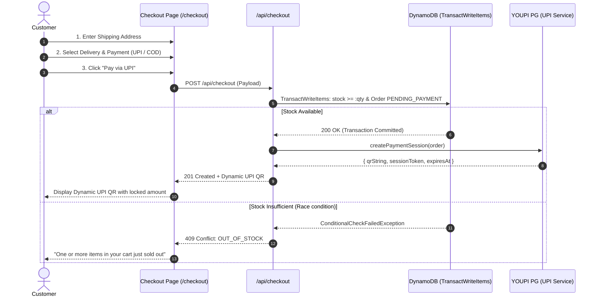
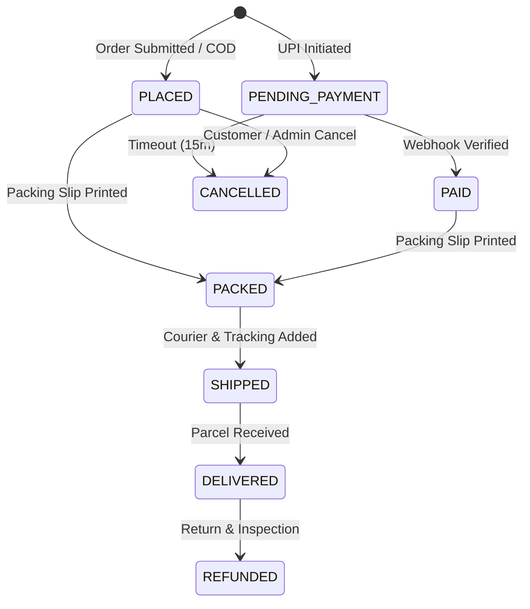

# Comprehensive Step-by-Step Usage Guide — Parnika Jewellers

> **Target Platform:** Next.js 14 (App Router, TypeScript) • Amazon DynamoDB • Amazon S3 • Amazon CloudFront • YOUPI PG / Licensed Gateway  
> **Brand Identity:** Deep Silk Maroon (`#7A262D`), Velvet Maroon (`#4A1118`), Temple Gold (`#D4AF5A`), Champagne Gold (`#E9D08A`), Warm Silk Creams (`#F7F0DE`), Neutral Ivory  
> **Brand Assets:** Heritage Crest (`/brand/crest.jpg`), Signature Brand Emblem (`/brand/emblem.webp`), Damask Silk Texture (`/brand/texture.jpg`)  
> **Compliance:** Indian GST (HSN 7117, GSTIN: 27AAAAA0000A1Z5) • Digital Personal Data Protection (DPDP) Act 2023  
> **Documentation Suite:** [Docs/architecture.md](Docs/architecture.md) • [Docs/implementationplan.md](Docs/implementationplan.md) • [Docs/evals.md](Docs/evals.md) • [Docs/production-cutover.md](Docs/production-cutover.md)

---

## Table of Contents

1. [System Overview & Architecture Tenets](#1-system-overview--architecture-tenets)
2. [Environment Configuration, Initial Bootstrap & Viewing Outputs](#2-environment-configuration-initial-bootstrap--viewing-outputs)
   - [2.1 Prerequisites](#21-prerequisites)
   - [2.2 Environment Variables Setup](#22-environment-variables-setup)
   - [2.3 Database Provisioning & DBI Catalog Seeding](#23-database-provisioning--dbi-catalog-seeding)
   - [2.4 Step-by-Step Instructions to View Outputs](#24-step-by-step-instructions-to-view-outputs)
3. [Customer Storefront Workflows](#3-customer-storefront-workflows)
   - [3.1 Luxury Homepage & Live Gold Rate Ticker](#31-luxury-homepage--live-gold-rate-ticker)
   - [3.2 Browsing & Multi-Faceted Catalog Filtering](#32-browsing--multi-faceted-catalog-filtering)
   - [3.3 Product Detail Page (PDP) & Image Gallery](#33-product-detail-page-pdp--image-gallery)
   - [3.4 1-Click WhatsApp Enquiry](#34-1-click-whatsapp-enquiry)
   - [3.5 Persistent Cart & Luxury Slide-Out Drawer](#35-persistent-cart--luxury-slide-out-drawer)
   - [3.6 Coupon Engine & Discounts](#36-coupon-engine--discounts)
   - [3.7 Customer Login & Account ("Welcome to Parnika Jewellers")](#37-customer-login--account-welcome-to-parnika-jewellers)
   - [3.8 Atomic Checkout & Payment (Dynamic UPI QR / COD)](#38-atomic-checkout--payment-dynamic-upi-qr--cod)
   - [3.9 Customer Order Tracking & History](#39-customer-order-tracking--history)
   - [3.10 GST Tax Invoice Download](#310-gst-tax-invoice-download)
   - [3.11 DPDP Privacy Portal & Data Erasure](#311-dpdp-privacy-portal--data-erasure)
4. [Store Administrator & Staff Workflows](#4-store-administrator--staff-workflows)
   - [4.1 Admin Authentication & RBAC](#41-admin-authentication--rbac)
   - [4.2 Real-Time Inventory Dashboard & Low-Stock Alerts](#42-real-time-inventory-dashboard--low-stock-alerts)
   - [4.3 Adding / Editing Products with Direct S3 Uploads](#43-adding--editing-products-with-direct-s3-uploads)
   - [4.4 Bulk Catalog CSV Import](#44-bulk-catalog-csv-import)
   - [4.5 Order Fulfillment & Packing Slips](#45-order-fulfillment--packing-slips)
   - [4.6 Payment Reconciliation & Observer Health](#46-payment-reconciliation--observer-health)
   - [4.7 Coupon Management](#47-coupon-management)
5. [Recommended Production Hosting & Deployment (AWS Mumbai ap-south-1)](#5-recommended-production-hosting--deployment-aws-mumbai-ap-south-1)
6. [Disaster Recovery & Nightly S3 Backups](#6-disaster-recovery--nightly-s3-backups)
7. [Automated Verification & Test Harnesses](#7-automated-verification--test-harnesses)
8. [API Reference & Payload Examples](#8-api-reference--payload-examples)

---

## 1. System Overview & Architecture Tenets

Parnika Jewellers Online Store is engineered specifically for premium fashion and one-gram gold imitation jewellery. It is built around six inviolable architectural tenets:

1. **Repository Abstraction:** Components and API route handlers interact solely with interfaces defined in `lib/data/interfaces/`. DynamoDB operations, fallback in-memory stores, and query optimizations remain decoupled from UI layers.
2. **Zero-Oversell Guarantee:** All inventory decrements execute through DynamoDB conditional atomic update expressions (`stock >= :qty` inside `TransactWriteItems`). Race conditions during flash sales halt safely before payment capture.
3. **Pluggable Payments:** All payment flows interface with a unified `IPaymentProvider` contract. The self-hosted YOUPI PG (V2) gateway handles dynamic UPI QR generation, while an official Razorpay adapter acts as a zero-downtime fallback.
4. **Direct Media Pipeline:** Administrative image uploads stream directly from the browser to Amazon S3 via short-lived pre-signed PUT URLs, completely bypassing the Next.js application server.
5. **Mobile-First Luxury Performance:** Designed for mobile shoppers on 4G/3G networks, featuring responsive WebP/AVIF images, authentic damask silk CSS patterns, pre-rendered static catalog routes, and target Lighthouse Mobile scores $\ge 85$.
6. **Statutory Tax & Privacy Compliance:** Automated Indian GST invoice generator (HSN 7117, CGST 1.5% + SGST 1.5% or IGST 3%) and full compliance with the Digital Personal Data Protection (DPDP) Act 2023.

---

## 2. Environment Configuration, Initial Bootstrap & Viewing Outputs

### 2.1 Prerequisites
- **Node.js:** v18.17+ or v20+ (Node.js 20+ recommended)
- **Package Manager:** npm (v9+)
- **AWS Account (Optional for Local Mode):** AWS IAM credentials scoped strictly to `parnika_*` DynamoDB tables and `parnika-jewellers-v0-*` S3 buckets. If AWS credentials are not configured, the application automatically activates built-in in-memory fallbacks.

### 2.2 Environment Variables Setup
Copy `.env.example` to `.env.local` and configure your environment:

```bash
cp .env.example .env.local
```

Key environment configuration properties:

| Variable | Description | Default / Example Value |
|---|---|---|
| `NODE_ENV` | Application environment | `development` / `production` |
| `AWS_REGION` | AWS Data Center region | `ap-south-1` (Mumbai) |
| `AWS_ACCESS_KEY_ID` | AWS IAM Access Key ID | `AKIA...` |
| `AWS_SECRET_ACCESS_KEY` | AWS IAM Secret Access Key | `...` |
| `DYNAMO_TABLE_PREFIX` | Prefix for DynamoDB tables | `parnika_` |
| `S3_BUCKET_NAME` | Dedicated S3 bucket for media & invoices | `parnika-jewellers-v0-prod` |
| `CLOUDFRONT_DISTRIBUTION_DOMAIN` | CloudFront CDN hostname | `assets.parnikajewellers.com` |
| `JWT_SECRET` | 64-char secret for session tokens | `parnika_secure_jwt_secret_token_min_32_bytes_long` |
| `ADMIN_BOOTSTRAP_EMAIL` | Initial store owner login email | `admin@parnikajewellers.com` |
| `ADMIN_BOOTSTRAP_PASSWORD` | Initial store owner login password | `AdminParnika@2026` |
| `PAYMENT_PROVIDER` | Selected gateway adapter | `youpi` (or `razorpay`) |
| `YOUPI_BASE_API_URL` | YOUPI PG microservice endpoint | `https://pg.parnikajewellers.com/api/v2` |
| `YOUPI_WEBHOOK_SECRET` | HMAC-SHA256 signature key | `youpi_dev_webhook_secret_key_32_bytes` |
| `YOUPI_MERCHANT_UPI_HANDLE` | Store UPI VPA for dynamic QR generation | `parnikajewellers@icici` |

### 2.3 Database Provisioning & DBI Catalog Seeding

Execute the automated database setup and initial data seeding:

```bash
# 1. Create all 8 DynamoDB tables and Global Secondary Indexes (GSIs)
npm run setup:dynamo

# 2. Seed authentic DBI catalogue items (Long Harams, Temple Sets, Ruby & Emerald Pieces)
npm run seed
```

Tables initialized with the `parnika_` prefix:
- `parnika_products`: Main catalog items, jewellery specs, stock counts, and S3 image keys.
- `parnika_categories`: Hierarchical category taxonomy (Long Haram Sets, Bridal & Temple, Ruby & Emerald, Floral & Layered).
- `parnika_orders`: Transactional orders with items snapshot, courier tracking, and payment status.
- `parnika_users`: Customer profiles, phone numbers, addresses, and DPDP status.
- `parnika_coupons`: Active promotion codes, minimum cart rules, and usage counters.
- `parnika_payments`: Webhook transaction log, provider references, and reconciliation status.
- `parnika_settings`: Key-value store for global settings and tax identifiers.
- `parnika_audit_logs`: Immutable audit trail for pricing changes, stock overrides, and administrative mutations.

### 2.4 Step-by-Step Instructions to View Outputs

You can view and test the application using two different methods:

#### Option A: Running the Full-Stack Next.js Application (Live Store)
This is the complete interactive webstore with database connectivity, API routes, cart drawer, checkout, and admin panel.

1. **Start the Next.js development server:**
   ```bash
   npm run dev
   ```
2. **Open the browser URLs:**
   - **Storefront Homepage:** [http://localhost:3000](http://localhost:3000)
   - **Catalog Browser:** [http://localhost:3000/catalog](http://localhost:3000/catalog)
   - **Customer Login Page:** [http://localhost:3000/account/login](http://localhost:3000/account/login)
   - **Admin Management Portal:** [http://localhost:3000/admin](http://localhost:3000/admin)  
     *(Log in with `admin@parnikajewellers.com` / `AdminParnika@2026`)*
   - **DPDP Privacy Rights Portal:** [http://localhost:3000/privacy](http://localhost:3000/privacy)

#### Option B: Standalone Offline Visual Prototype
If you want to view the standalone, single-file HTML benchmark without starting Node.js or a server:

1. **Directly open in your default browser:**
   - On Windows PowerShell:
     ```powershell
     Start-Process "parnika-jewellers-store.html"
     ```
   - On macOS:
     ```bash
     open parnika-jewellers-store.html
     ```
2. **Or serve via static local server:**
   ```bash
   npx serve . -p 8080
   ```
   Then navigate to [http://localhost:8080/parnika-jewellers-store.html](http://localhost:8080/parnika-jewellers-store.html).

---

## 3. Customer Storefront Workflows

### 3.1 Luxury Homepage & Live Gold Rate Ticker
The homepage at `/` incorporates royal Indian jewellery aesthetics:

- **Top Announcement Bar:** Displays the live 24K gold rate (`₹6,840/g`), free insured delivery disclosure across India, and direct WhatsApp concierge support.
- **Sticky Frosted Glass Navbar (`.glass-nav`):** Contains the circular royal crest avatar, catalog navigation, live search bar, wishlist counter, and cart drawer launcher.
- **Hero Section:** Features a high-contrast royal showcase with dual action buttons (`.btn-gold` "Explore Collection" and `.btn-line` "Custom Bridal Orders") and a floating royal crest badge.
- **Shop by Style 4-Category Grid:**
  1. *Long Haram Sets* — Grand 3-line and temple harams.
  2. *Bridal & Temple* — Heritage nakshi and goddess motifs.
  3. *Ruby & Emerald* — Kemp stone, teardrop and leaf designs.
  4. *Floral & Layered* — Modern layered necklaces and chokers.
- **Festive Special 20% OFF Bridal Offer:** Highlighted promo box with one-click code copy.
- **Our Story / Craft Guarantee:** Highlights *Insured Express Shipping*, *48-Hour Inspection & Returns*, and *100% Secure UPI & Card Payments*.
- **Social Proof Gallery:** Visual photo grid featuring real jewellery sets with `@ParnikaJewellers` badges.

---

### 3.2 Browsing & Multi-Faceted Catalog Filtering
Navigate to the storefront catalog at `/catalog`:

- **Category Switching:** Click on category chips (e.g. *Long Haram Sets*, *Bridal & Temple*, *Ruby & Emerald*, *Floral & Layered*).
- **Price Range Filter:** Use the interactive price slider or preset checkboxes to constrain results (e.g., ₹1,000 – ₹5,000).
- **Material Finish:** Filter by *Antique Temple Gold*, *Matte 24K Micro Gold*, *Glossy Yellow Gold*, or *Ruby Inlay*.
- **In-Stock Only:** Toggle "In Stock Only" to filter out out-of-stock pieces.
- **Authentic DBI SKU Display:** Every product card proudly displays its authentic supplier code (e.g., `DBI-07.1715`, `DBI-10.2360`, `DBI-06.1525`).
- **Sorting:** Sort by *Price: Low to High*, *Price: High to Low*, or *Newest Arrivals*.

**Example Query URL:**
```
http://localhost:3000/catalog?category=cat-necklaces&minPrice=1000&maxPrice=5000&inStock=true&sort=price_asc
```

---

### 3.3 Product Detail Page (PDP) & Image Gallery
Click any product card or navigate directly to `/product/[slug]` (e.g. `/product/one-gram-gold-necklace`):

1. **High-Resolution Gallery & Desktop Zoom:** Hover your cursor over the primary photo to trigger magnification; click thumbnail cards to switch gallery angles.
2. **Transparent Jewellery Specifications Table:** Displays Base Metal (`Copper Alloy`), Plating (`24K Micro Gold`), Finish, Weight, and Polish Warranty details.
3. **Transparent Pricing Box:** Shows Current Selling Price, MRP with strike-through, and calculated percentage discount badge.

---

### 3.4 1-Click WhatsApp Enquiry
Jewellery shoppers frequently ask about custom sizing, matching bangles, or video consultations before buying:

1. On the product detail page, click the gold/emerald **"Enquire on WhatsApp"** button.
2. The browser launches WhatsApp with an automatically pre-filled, strictly URL-encoded message containing:
   - Product Name
   - SKU & Supplier Code
   - Current Price
   - Live URL link
3. **URL Pattern:**
   ```
   https://wa.me/919876543210?text=Hi%20Parnika%20Jewellers%2C%20I%20am%20interested%20in%20Antique%20Gold%20Long%20Haram%20Set%20(SKU%3A%20DBI-07.1715%2C%20Price%3A%20%E2%82%B93%2C499).%20Is%20it%20available%3F%20http%3A%2F%2Flocalhost%3A3000%2Fproduct%2Fone-gram-gold-necklace
   ```

---

### 3.5 Persistent Cart & Luxury Slide-Out Drawer
Click **"Add to Cart"** or the shopping bag icon in the header:

1. **Luxury Slide-Out Drawer:** Slides smoothly from the right with damask silk accents.
2. **Free Shipping Progress Bar:** Shows progress toward the ₹999 free shipping threshold (e.g., *"Add ₹150 more for FREE Insured Express Shipping"*).
3. **Guest Cart Persistence:** Cart state is immediately saved to browser `LocalStorage`.
4. **Logged-In Sync:** When a customer logs in, their guest cart seamlessly merges with `parnika_carts` in DynamoDB without duplicating quantities.
5. **Real-Time Stock Clamping:** If an item's available inventory drops below the customer's cart quantity (e.g. from an in-store sale), opening the cart automatically clamps the line quantity to available stock and alerts the customer:
   > *"Item quantity adjusted to available inventory."*

---

### 3.6 Coupon Engine & Discounts
In `/cart`, the slide-out drawer, or at `/checkout`:

1. Enter a valid coupon code (e.g., `FESTIVE500` or `WELCOME10`) into the promo code field and click **"Apply"**.
2. **Boundary Validation Rules:**
   - Verifies `active === true`.
   - Current timestamp is within `validFrom` and `validTo`.
   - Cart subtotal meets `minCart` (e.g. minimum cart value of ₹2,500 required for flat ₹500 off).
   - Global usage counter has not exceeded `usageLimit`.
3. If valid, the price summary updates immediately to show the discount deduction before tax.

---

### 3.7 Customer Login & Account ("Welcome to Parnika Jewellers")
Navigate to `/account/login`:

1. **Header & Brand Emblem:** Features the circular royal crest avatar (`/brand/crest.jpg`), heading **"Welcome to Parnika Jewellers"**, and subheading *"Log in to manage orders, saved addresses, and jewellery wishlists."*
2. **Dual Authentication Tabs:**
   - **Tab 1: Phone OTP (Fast):**
     - Mobile Number input with fixed `+91` Indian prefix.
     - Click **"Send Login OTP"**.
     - In demo/development environments, a helper hint reveals the active OTP.
     - Enter 6-digit verification code to log in instantly.
   - **Tab 2: Email & Password:**
     - Traditional email and password sign-in with client-side format validation.
3. **Post-Login State:** Redirects the customer directly to their intended destination (checkout or order history) with an `httpOnly` secure session.

---

### 3.8 Atomic Checkout & Payment (Dynamic UPI QR / COD)
Navigate to `/checkout` to complete your purchase:



#### Payment Method A: Dynamic UPI QR (YOUPI PG)
1. Select **"Dynamic UPI QR / Online Payment"**.
2. The server reserves stock atomically via `ConditionExpression: "stock >= :qty"` and calls the YOUPI PG adapter.
3. A dynamic UPI QR code renders on-screen with the **exact locked amount** and a **unique transaction reference** in the UPI note (`tn=PJ-ORD-XXXXX`).
4. Scan the QR code using Google Pay, PhonePe, Paytm, or BHIM.
5. Upon bank receipt, the observer fires a server-to-server webhook to mark the order `PAID`.

#### Payment Method B: Cash on Delivery (COD)
1. Select **"Cash on Delivery"**.
2. **Ceiling Rule:** COD is restricted to orders up to ₹10,000. Carts exceeding ₹10,000 automatically display an alert:
   > *"Cash on Delivery is limited to orders up to ₹10,000. Please select Online UPI Payment."*
3. Clicking confirm creates the order directly with status `orderStatus: PLACED` and `paymentStatus: PENDING_COD`.

---

### 3.9 Customer Order Tracking & History
Access `/account/orders` or direct tracking link `/account/orders/[orderNo]`:

- **Visual Order Progression Bar:**
  $$\text{Order Placed} \longrightarrow \text{Packed} \longrightarrow \text{Shipped} \longrightarrow \text{Delivered}$$
- **Live Courier Tracking:** When staff dispatches the parcel with a tracking number, a direct tracking button appears pointing to the courier portal (e.g. Delhivery, Shiprocket, India Post).
- **1-Click Re-Order:** Adds all items from a past order back into the cart.

---

### 3.10 GST Tax Invoice Download
Once an order is marked `PAID` or dispatched:

1. In `/account/orders/[orderNo]`, click **"Download Tax Invoice"** (or make an authenticated call to `GET /api/orders/[id]/invoice`).
2. The server streams a PDF document (`application/pdf`) conforming to the Central Goods and Services Tax (CGST) Act:
   - Store GSTIN: `27AAAAA0000A1Z5`
   - Consecutive Invoice Number: `INV-2026-XXXXX`
   - HSN Code: `7117` (Imitation Jewellery)
   - Intra-State: CGST (1.5%) + SGST (1.5%) = 3%
   - Inter-State: IGST (3%) = 3%

---

### 3.11 DPDP Privacy Portal & Data Erasure
Parnika Jewellers complies fully with the India Digital Personal Data Protection (DPDP) Act 2023.

1. Navigate to the footer link **"Privacy Policy (DPDP Act)"** or visit `/privacy`.
2. Scroll to the **"Exercise Your Right to Erasure"** portal.
3. Enter your registered 10-digit mobile number and click **"Submit Data Erasure Request"**.
4. The system:
   - Redacts personal identifiers (`name`, `phone`, `email`, `addresses`, `wishlist`, `passwordHash`) from `parnika_users`.
   - Preserves statutory order tax records for the mandatory 6-year period under Section 36 of the CGST Act 2017.
   - Logs an immutable regulatory audit record in `parnika_audit_logs`.

---

## 4. Store Administrator & Staff Workflows

### 4.1 Admin Authentication & RBAC
Navigate to `/admin/login`:

1. **Credentials:**
   - **Email:** `admin@parnikajewellers.com` (or value of `ADMIN_BOOTSTRAP_EMAIL`)
   - **Password:** `AdminParnika@2026` (or value of `ADMIN_BOOTSTRAP_PASSWORD`)
2. The authentication endpoint verifies password hashes using `bcrypt` and issues an `httpOnly`, `Secure` JWT session cookie (`admin_session`) valid for 8 hours.
3. Next.js middleware enforces strict role verification on all `/admin/*` and `/api/admin/*` endpoints, returning `HTTP 403 Forbidden` if a customer session attempts access.

---

### 4.2 Real-Time Inventory Dashboard & Low-Stock Alerts
Access `/admin/inventory`:

- **Data Table View:** Displays Product Thumbnail, Title, SKU, Supplier Code (e.g. `DBI-07.1715`), Selling Price, Cost Price, Stock Count, and Status toggle (`ACTIVE`, `DRAFT`, `ARCHIVED`).
- **Low-Stock Alert Badges:** Highlights items in ruby red where $\mathtt{stock} \le \mathtt{lowStockAt}$.
- **Search & Filter:** Search instantly by title, SKU, or supplier code; filter by category or "Low Stock Only".

---

### 4.3 Adding / Editing Products with Direct S3 Uploads
Click **"Add New Product"** (`/admin/inventory/new`):

1. **Basic Info:** Name, auto-generated URL slug, category, and tags.
2. **Pricing & Margins:** Enter Selling Price, MRP, and Cost Price (margin percentage calculates dynamically).
3. **Jewellery Specifications:** Add attributes like Finish, Base Metal, Plating, Weight, and Care notes.
4. **Direct S3 Image Upload Pipeline:**
   - Drag and drop up to 5 images into the uploader.
   - The browser calls `/api/admin/uploads/sign`, receives a signed S3 PUT URL, and uploads binary data directly to S3.
   - Drag thumbnails to re-order the gallery and set the primary cover photo.

---

### 4.4 Bulk Catalog CSV Import
Click **"Bulk CSV Import"** (`/admin/inventory/bulk`):

1. **Download CSV Template:** Click "Download Template" to get headers:
   ```csv
   title,sku,supplierCode,category,price,mrp,costPrice,stock,imageUrls,description
   ```
2. **Example Row:**
   ```csv
   Antique Gold Long Haram Set,PJ-NK-101,DBI-07.1715,cat-necklaces,3499,6999,1750,5,https://assets.parnikajewellers.com/products/p1715.webp,Grand 3-line traditional haram with peacock motifs.
   ```
3. **Upload & Batch Processing:** The parser validates all rows against Zod schemas, auto-generates missing SKUs, and writes valid items in batches of 25 using DynamoDB `BatchWriteItem`.
4. **Error Reporting Modal:** If invalid rows exist, a modal lists exact row numbers and validation failure reasons while successfully importing all valid rows.

---

### 4.5 Order Fulfillment & Packing Slips
Navigate to `/admin/orders`:



1. **Transition to PACKED:** Open order detail view and click **"Mark as Packed"**. Click **"Print Packing Slip"** to generate a warehouse picking slip containing item SKUs, supplier codes, barcodes, and fulfillment check-boxes.
2. **Transition to SHIPPED:**
   - Select Courier Partner (`Delhivery`, `Shiprocket`, `Blue Dart`, `India Post`).
   - Enter Courier Tracking Number (e.g., `DEL-9988776655`).
   - Click **"Mark as Shipped"**.
   - The system automatically:
     - Saves tracking URL.
     - Dispatches an automated shipping email to the customer.
     - Prepares a 1-click WhatsApp dispatch update link for the store owner.
3. **Transition to DELIVERED:** Confirms parcel receipt.

---

### 4.6 Payment Reconciliation & Observer Health
Navigate to `/admin/payments`:

1. **Observer Health Status:** Shows live connectivity cards for:
   - Bank SMS Observer Service
   - Gmail Notification Observer
   - Gateway Webhook Receiver
2. **Unmatched Payments Queue:** If an observer receives a UPI payment with an ambiguous reference or mismatched amount, the record is placed in `PARTIALLY_PAID_HOLD`.
3. **Manual Reconciliation:** Staff can click **"Reconcile Manually"**, enter the matching Order ID, and settle the transaction with an immutable audit log record.

---

### 4.7 Coupon Management
Navigate to `/admin/coupons`:

- Click **"Create Coupon"** to configure new discount campaigns:
  - **Type:** Percentage discount or Flat INR amount.
  - **Value:** e.g., 10% or ₹500.
  - **Minimum Cart:** e.g., ₹2,500.
  - **Usage Limits:** Global usage cap and per-customer limit.
  - **Validity:** Start date and expiration date.
  - **Status:** Activate or deactivate instantly.

---

## 5. Recommended Production Hosting & Deployment (AWS Mumbai ap-south-1)

For hosting `www.parnikajewellers.com` in production (connected via GoDaddy to AWS Amplify):

### 5.1 Architecture Plan
```
               [ GoDaddy DNS (parnikajewellers.com) ]
                               │
                               ▼
               [ AWS CloudFront CDN / Amplify Edge ]
                               │
         ┌─────────────────────┴─────────────────────┐
         ▼                                           ▼
[ AWS Amplify Hosting (ap-south-1) ]        [ Amazon S3 (ap-south-1) ]
 - Next.js 14 SSR & Server Components       - Media & Invoices
 - API Route Handlers (/app/api/*)          - CloudFront OAC Protected
         │
         ▼
[ Amazon DynamoDB (ap-south-1) ]
 - Conditional atomic updates (stock >= :qty)
 - GSIs on orders, users, coupons
```

1. **Host Next.js on AWS Amplify Hosting (Mumbai / ap-south-1):**
   - Supports SSR, ISR, and Route Handlers out-of-the-box.
   - Zero CORS issues: Next.js API routes (`app/api/*`) serve frontend and backend on the same origin (`www.parnikajewellers.com`).
   - Auto-deploys straight from GitHub commits on the `main` branch.
   - Automated SSL certificates via Amazon Trust Services.
   - GoDaddy DNS CNAME record routes `www.parnikajewellers.com` directly to Amplify.
2. **S3 Behind CloudFront OAC:**
   - Media bucket is completely private. CloudFront Origin Access Control (OAC) signs all image requests.
3. **Payment Gateway Security:**
   - Dynamic UPI Webhooks: Only mark orders as `PAID` upon verified HMAC-SHA256 signature from the server-to-server webhook, never relying solely on browser redirects.
   - Keep all credentials (`YOUPI_WEBHOOK_SECRET`, `JWT_SECRET`) securely in AWS Secrets Manager or Amplify environment variables.
4. **Turnkey Alternative (Vercel):**
   - Vercel selecting the Mumbai (`bom1`) region provides zero-config Next.js hosting and connects securely to DynamoDB and S3 in `ap-south-1`.

---

## 6. Disaster Recovery & Nightly S3 Backups

Parnika Jewellers includes an automated backup pipeline to protect customer and inventory records:

```bash
# Execute on-demand backup snapshot of all 8 tables
npm run backup:tables
```

### How the Backup Pipeline Works
1. Scans all 8 tables (`parnika_products`, `parnika_categories`, `parnika_orders`, `parnika_users`, `parnika_coupons`, `parnika_payments`, `parnika_settings`, `parnika_audit_logs`).
2. Serializes data to JSON and compresses using Gzip (`zlib`).
3. Computes a SHA-256 integrity hash for each table archive.
4. Uploads to S3: `s3://parnika-jewellers-v0-prod/backups/<YYYY-MM-DD>/<table_name>.json.gz`.
5. Uploads a signed `manifest.json` detailing record counts, sizes, and hashes.

### Automated AWS EventBridge Scheduling
To configure the backup script to run nightly at 02:00 UTC (07:30 AM IST) in AWS:

```bash
aws events put-rule \
  --name "ParnikaJewellers-Nightly-DynamoDB-Backup" \
  --schedule-expression "cron(0 2 * * ? *)" \
  --state ENABLED \
  --description "Nightly export of all 8 parnika_* DynamoDB tables to S3 gzip archives" \
  --region ap-south-1
```

---

## 7. Automated Verification & Test Harnesses

The repository includes a comprehensive, phase-by-phase test and evaluation suite defined in [Docs/evals.md](Docs/evals.md):

| Command | Target Milestone / Scenario | Verification Goal |
|---|---|---|
| `npm run typecheck` | TypeScript Compiler (`tsc --noEmit`) | Strict type safety with 0 errors across codebase |
| `npm run test:eval-p0` | Phase 0: Infrastructure & DAL | Table prefixing, Zod env validation, S3 isolation |
| `npm run test:eval-p1` | Phase 1: Brand System & Auth | Color tokens, customer JWTs, bcrypt admin credentials, RBAC |
| `npm run test:eval-p2` | Phase 2: Catalog & Media | Pre-signed upload API, multi-faceted filtering, WhatsApp CTA |
| `npm run test:eval-p3` | Phase 3: Admin & Inventory | SKU search, low-stock badges, 50-row CSV parser, audit logs |
| `npm run test:eval-p4` | Phase 4: Cart & Coupons | Cart sync, coupon boundary rules, atomic stock decrement |
| `npm run test:eval-p5` | Phase 5: Payments & Webhooks | IPaymentProvider, dynamic UPI QR, COD limit, HMAC webhook |
| `npm run test:eval-p6` | Phase 6: Orders & Invoicing | Status transitions, GST PDF invoices, tracking, email/WhatsApp |
| `npm run test:eval-p7` | Phase 7: Hardening & Security | Concurrency stress test, DPDP erasure, S3 backup, E2E smoke (15/15 passed) |
| `npm run test:load-stock`| Concurrency Stress Test | 20 users competing for 2 items; 50 users across 5 items |
| `npm run test:smoke-e2e` | End-to-End Smoke Test | Complete customer buying cycle from catalog to invoice |

---

## 8. API Reference & Payload Examples

### 8.1 Checkout Order Placement
**Endpoint:** `POST /api/checkout`

```bash
curl -X POST http://localhost:3000/api/checkout \
  -H "Content-Type: application/json" \
  -d '{
    "items": [
      { "productId": "b3f27a1e-84b9-4c12-921a-123456789abc", "quantity": 1 }
    ],
    "shippingAddress": {
      "fullName": "Smt. Ananya Rao",
      "phone": "9876543210",
      "street": "12-A Lotus Enclave, Banjara Hills",
      "city": "Hyderabad",
      "state": "Telangana",
      "pincode": "500034"
    },
    "shippingMethod": "standard",
    "paymentMethod": "youpi",
    "couponCode": "FESTIVE500",
    "userId": "customer-123"
  }'
```

---

### 8.2 Customer OTP Send & Verify
**Endpoints:** `POST /api/account/auth/otp/send` and `POST /api/account/auth/otp/verify`

```bash
# 1. Send OTP
curl -X POST http://localhost:3000/api/account/auth/otp/send \
  -H "Content-Type: application/json" \
  -d '{ "phone": "9876543210" }'

# 2. Verify OTP and receive JWT session
curl -X POST http://localhost:3000/api/account/auth/otp/verify \
  -H "Content-Type: application/json" \
  -d '{ "phone": "9876543210", "otp": "123456" }'
```

---

### 8.3 YOUPI PG Webhook Ingestion
**Endpoint:** `POST /api/payments/webhook/youpi`

```bash
# Headers:
# Content-Type: application/json
# x-youpi-signature: <HMAC_SHA256_OF_BODY_USING_YOUPI_WEBHOOK_SECRET>

curl -X POST http://localhost:3000/api/payments/webhook/youpi \
  -H "Content-Type: application/json" \
  -H "x-youpi-signature: 8f9b2d3e...e1a2" \
  -d '{
    "providerRef": "UPI-TXN-99887766",
    "orderId": "a1b2c3d4-e5f6-7890-abcd-ef1234567890",
    "orderNo": "PJ-2026-0042",
    "amount": 2999,
    "status": "SUCCESS",
    "timestamp": "2026-11-15T00:15:00.000Z"
  }'
```

---

### 8.4 DPDP Customer Data Erasure Request
**Endpoint:** `POST /api/account/privacy/erasure`

```bash
curl -X POST http://localhost:3000/api/account/privacy/erasure \
  -H "Content-Type: application/json" \
  -d '{
    "phone": "9876543210",
    "reason": "Customer statutory data erasure request under DPDP Act 2023"
  }'
```

**Success Response (`HTTP 200 OK`):**
```json
{
  "success": true,
  "data": {
    "userId": "a1b2c3d4-e5f6-7890-abcd-ef1234567890",
    "phone": "REDACTED_a1b2c3d4",
    "redactedFields": ["name", "phone", "email", "addresses", "wishlist", "passwordHash"],
    "statutoryTaxRecordsRetained": 2,
    "auditLogId": "c4d5e6f7-1234-5678-9abc-def012345678",
    "message": "Customer PII successfully scrubbed from active profile in compliance with India DPDP Act 2023. 2 order transaction(s) retained under Section 36 of CGST Act 2017 for statutory 6-year tax compliance."
  }
}
```
