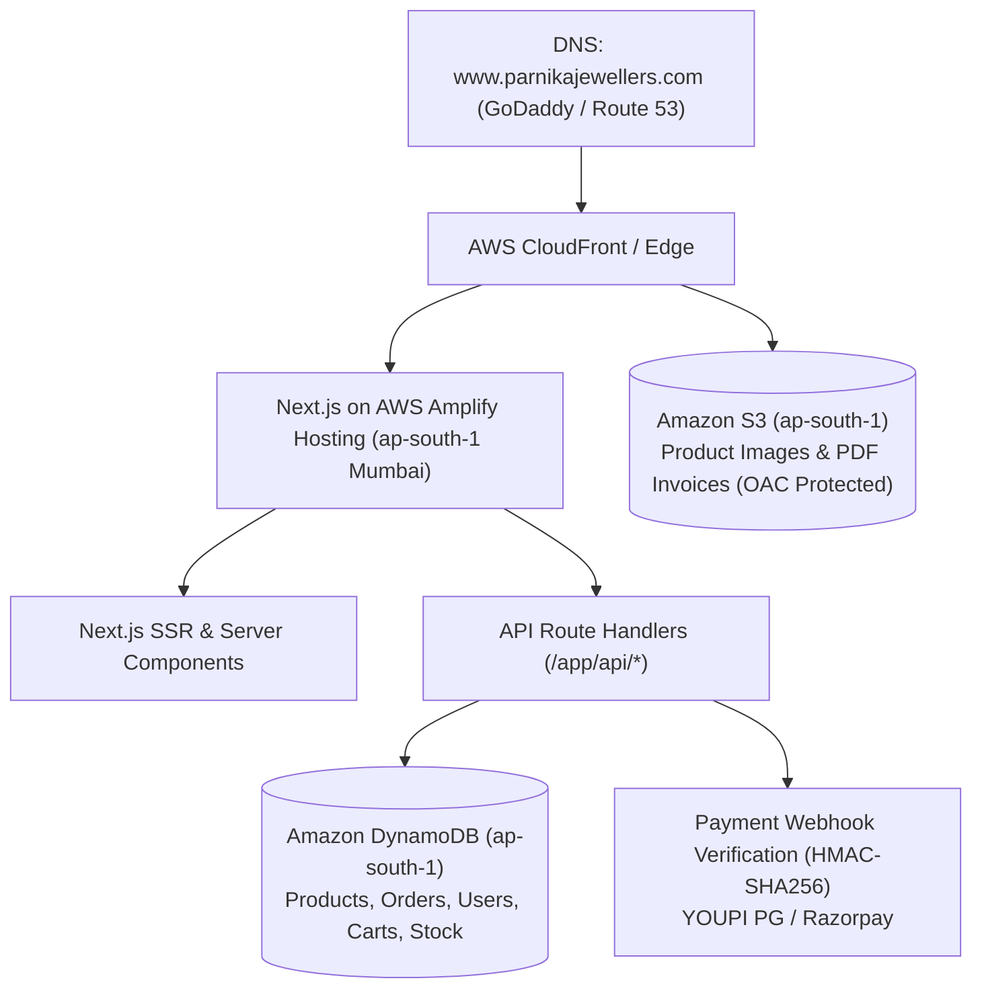

# Parnika Jewellers — Online Store

[](https://nextjs.org/)
[](https://www.typescriptlang.org/)
[](https://tailwindcss.com/)
[](https://aws.amazon.com/dynamodb/)
[](https://aws.amazon.com/s3/)
[](https://upi.org/)
[](https://www.meity.gov.in/)

> High-performance luxury e-commerce web application engineered specifically for **Parnika Jewellers** — traditional royal temple artistry, premium fashion jewellery, and authentic 1-gram micro gold collections.

---

## 🏛️ Architectural Tenets Enforced Throughout

1. **Repository Abstraction:** All data access routes through strict interfaces in `lib/data/interfaces/`. DynamoDB, local mock fallbacks, and schema evolution are 100% decoupled from UI components and API handlers.
2. **Zero-Oversell Guarantee:** Every inventory decrement executes via DynamoDB conditional atomic update expressions (`stock >= :qty` in `TransactWriteItems`), preventing overselling during concurrent checkouts or flash sales.
3. **Pluggable Payment Subsystem:** Payment flows adhere to a unified `IPaymentProvider` contract. Self-hosted **YOUPI PG (V2)** provides dynamic UPI QR codes with locked transaction notes, while an official **Razorpay** adapter provides zero-downtime fallback.
4. **Direct S3 Media Pipeline:** Store managers upload jewellery imagery directly from the browser to Amazon S3 via short-lived pre-signed PUT URLs, completely bypassing the Node.js server.
5. **Mobile-First Luxury Performance:** Optimized for 4G/3G mobile networks across India with responsive WebP/AVIF images, damask silk CSS textures, pre-rendered static catalog routes, and target Lighthouse Mobile scores $\ge 85$.
6. **Regulatory Compliance:** Automated Indian GST tax invoice generation (HSN 7117, CGST 1.5% + SGST 1.5% or IGST 3%) and full statutory compliance with the **Digital Personal Data Protection (DPDP) Act, 2023**.

---

## 🎨 Visual Identity & Brand Design System

Extracted directly from the royal heritage crest and the authentic boutique benchmark (`parnika-jewellers-store.html`):

| Token | Hex Code | Visual Application |
|---|---|---|
| **Deep Silk Maroon (`--m`)** | `#7A262D` | Primary brand color, hero badges, button fills, top borders |
| **Dark Velvet Maroon (`--m2`)** | `#4A1118` | Headings, sticky glass navigation, royal card borders |
| **Night Maroon (`--m3`)** | `#2E0A0F` | Deep contrast panels, crest badge backdrops, dark cards |
| **Obsidian Dark (`--m4`)** | `#080706` | Global page body canvas |
| **Damask Silk Pattern** | `/brand/texture.jpg` | Authentic woven Indian silk texture (`.tex`, `.tex-m`, `.tex-d`, `.tex-dd`) |
| **Temple Gold (`--gold`)** | `#D4AF5A` | Primary metallic accents, CTAs (`.btn-gold`), star ratings, dividers |
| **Light Champagne Gold (`--gold-l`)** | `#E9D08A` | Hover states, glowing borders, announcement ticker text |
| **Antique Gold (`--gold-d`)** | `#8A6A22` | Deep shadow accents, outline buttons (`.btn-line`) |
| **Warm Silk Cream (`--cream`)** | `#F7F0DE` | Light card backgrounds, secondary buttons, product tags |
| **Muted Cream (`--cream-d`)** | `#E4D7C0` | Specification badges, pricing strike-through text |
| **Gold Filigree Line (`--line`)** | `#E6D7B4` | Card dividers, input borders, hairline table borders |

### Typography
- **Display Serif:** `Cormorant Garamond` — classic royal luxury serif for brand headings and prices.
- **Body Sans:** `Jost` — clean, modern geometric sans-serif for readability on mobile screens.

### Brand Assets (`public/brand/`)
- `public/brand/crest.jpg` — Royal heritage golden crest emblem.
- `public/brand/emblem.webp` — Circular signature brand insignia.
- `public/brand/texture.jpg` — Seamless royal damask silk background pattern.

---

## 👁️ How to View the Storefront Outputs

You can view the storefront in two ways:

### Option A: Live Full-Stack Next.js Application (Recommended)
Runs the full e-commerce stack with dynamic catalog browsing, live cart drawer, atomic stock reservation, checkout, and admin dashboard.

```bash
# 1. Install dependencies
npm install

# 2. Launch the development server
npm run dev
```

Open your browser to:
- **Customer Storefront:** [http://localhost:3000](http://localhost:3000)
- **Product Catalog:** [http://localhost:3000/catalog](http://localhost:3000/catalog)
- **Customer Login:** [http://localhost:3000/account/login](http://localhost:3000/account/login)
- **Admin Portal:** [http://localhost:3000/admin](http://localhost:3000/admin) (Credentials: `admin@parnikajewellers.com` / `AdminParnika@2026`)

### Option B: Standalone HTML Visual Prototype
The repository includes `parnika-jewellers-store.html`, an all-in-one standalone prototype matching the exact visual benchmark with embedded styles and product assets.

```bash
# On Windows PowerShell:
Start-Process "parnika-jewellers-store.html"

# Or serve via a simple static HTTP server:
npx serve . -p 8080
# then open http://localhost:8080/parnika-jewellers-store.html
```

---

## 🚀 Quick Start & Development Setup

### 1. Prerequisites
- **Node.js:** v18.17+ or v20+ (Node.js 20+ recommended)
- **Package Manager:** npm v9+
- **AWS Credentials (Optional):** If AWS credentials are not configured, the app runs automatically with built-in in-memory fallback stores.

### 2. Clone & Install
```bash
git clone https://github.com/sandeep83103/pjstoreV0.git
cd pjstoreV0
npm install
```

### 3. Environment Setup
```bash
cp .env.example .env.local
```

Configure your `.env.local`:
```ini
AWS_REGION=ap-south-1
AWS_ACCESS_KEY_ID=AKIA...
AWS_SECRET_ACCESS_KEY=...
DYNAMO_TABLE_PREFIX=parnika_
S3_BUCKET_NAME=parnika-jewellers-v0-prod
CLOUDFRONT_DISTRIBUTION_DOMAIN=assets.parnikajewellers.com
JWT_SECRET=your_secure_random_64_character_token_here
ADMIN_BOOTSTRAP_EMAIL=admin@parnikajewellers.com
ADMIN_BOOTSTRAP_PASSWORD=AdminParnika@2026
PAYMENT_PROVIDER=youpi
YOUPI_BASE_API_URL=https://pg.parnikajewellers.com/api/v2
YOUPI_WEBHOOK_SECRET=youpi_dev_webhook_secret_key_32_bytes
YOUPI_MERCHANT_UPI_HANDLE=parnikajewellers@icici
```

### 4. Initialize Database & Seed Catalog
```bash
# Provision all 8 DynamoDB tables with GSIs in ap-south-1
npm run setup:dynamo

# Seed authentic DBI product catalog (Long Harams, Temple Bridal Sets, Ruby & Emerald Sets)
npm run seed
```

---

## 🛍️ Feature Matrix

### Customer Storefront
- **Live Gold Rate Announcement Ticker:** Real-time 24K live gold rate (`₹6,840/g`), free insured delivery disclosure, and direct WhatsApp concierge hotline.
- **Sticky Damask Glass Navigation:** Frosted glass navbar (`.glass-nav`) with brand crest avatar, instant search, wishlist counter, and cart drawer launcher.
- **Dynamic Catalog Browsing (`/catalog`):** Multi-faceted filtering by Category, Price range, Material Finish (Antique Temple Gold, Matte Gold, Glossy Yellow, Ruby Inlay), and Stock availability.
- **Authentic DBI SKU Architecture:** Integrated with Parnika's real supplier codes (`DBI-07.1715`, `DBI-10.2360`, `DBI-06.1525`, `DBI-07.1749-R`, `DBI-07.1749-E`, `DBI-08.1770`, `DBI-09.2105`, `DBI-08.1989`).
- **Product Detail Page (`/product/[slug]`):** Desktop hover zoom, specifications table (Base Metal, Plating, Weight, Polish Warranty), strike-through MRP pricing, and 1-Click WhatsApp Enquiry with pre-filled SKU and URL.
- **Luxury Slide-Out Cart Drawer:** Real-time stock clamping, free shipping progress bar (₹999 threshold), and promo code input.
- **Customer Login Portal (`/account/login`):** Brand new "Welcome to Parnika Jewellers" interface with crest emblem, fast Phone OTP authentication tab, and traditional Email/Password tab.
- **Multi-Step Atomic Checkout (`/checkout`):** Address validation, delivery method selection, and instant Dynamic UPI QR generation with locked amount.
- **Order Tracking & Account Portal (`/account/orders`):** Visual status progression, direct courier partner tracking, and 1-click re-ordering.
- **GST Tax Invoices:** Streams GST-compliant PDF invoices with HSN 7117, store GSTIN (27AAAAA0000A1Z5), and tax breakdown.
- **DPDP Privacy Portal (`/privacy`):** Customer statutory Right to Erasure portal, PII redaction, and Grievance Officer details.

### Admin Management Portal (`/admin`)
- **Admin Authentication:** Role-based access control (RBAC), bcrypt hashing, and secure 8-hour session JWTs.
- **Inventory Dashboard (`/admin/inventory`):** Live stock levels, supplier code search (`DBI-102`), and ruby red low-stock alert badges.
- **Product Editor (`/admin/inventory/new`):** Direct-to-S3 multi-image drag-and-drop uploader, gallery re-ordering, and jewellery specs.
- **Bulk CSV Import (`/admin/inventory/bulk`):** Downloadable CSV template, 25-item batch write, and row-level error validation modal.
- **Order Pipeline (`/admin/orders`):** Order status transitions (`PLACED -> PAID -> PACKED -> SHIPPED -> DELIVERED`) and printable warehouse packing slips with SKU barcodes.
- **Payment Reconciliation (`/admin/payments`):** Live observer monitors (Bank SMS, Gmail, Gateway) and unmatched payment reconciliation.
- **Coupon Manager (`/admin/coupons`):** Create and track promotional campaign discount codes.

---

## ☁️ Recommended Deployment Architecture (AWS Mumbai ap-south-1)

For production deployment of `www.parnikajewellers.com`:



1. **Host Next.js on AWS Amplify Hosting (ap-south-1 Mumbai):**
   - Full native support for Next.js 14 App Router, SSR, and ISR.
   - Deploys automatically on git push to `main`.
   - Free SSL certificates via AWS Certificate Manager (ACM).
   - Keeps compute physically adjacent to DynamoDB and S3 in Mumbai for sub-10ms latency.
2. **Co-located API Handlers:**
   - Put all API endpoints inside Next.js (`app/api/...`) rather than running a separate Node server. Single domain, zero CORS complications.
3. **Images in S3 Behind CloudFront OAC:**
   - Media stored in S3 with Origin Access Control (OAC), keeping the bucket private while delivering fast globally via CloudFront.
4. **DynamoDB Conditional Writes:**
   - Zero-oversell guarantee enforced via `ConditionExpression: "stock >= :qty"` inside `TransactWriteItems`.
5. **Alternative Hosting:**
   - Vercel (selecting Mumbai region `bom1`) works seamlessly as a turnkey alternative with identical DynamoDB and S3 endpoints.

---

## 🧪 Comprehensive Verification & Test Suites

The project features automated evaluation suites for every implementation phase:

```bash
# Typecheck & Static Analysis
npm run typecheck

# Automated Milestone Evaluations
npm run test:eval-p0   # Foundation & Infrastructure (DynamoDB, S3 isolation, DAL)
npm run test:eval-p1   # Brand tokens, responsive shell, customer JWT, admin auth
npm run test:eval-p2   # S3 pre-signed upload API, multi-faceted filtering, WhatsApp CTA
npm run test:eval-p3   # Inventory table, bulk CSV parser, audit logging
npm run test:eval-p4   # Cart sync, coupon engine, atomic stock decrement
npm run test:eval-p5   # IPaymentProvider, dynamic UPI QR, COD limit, HMAC webhooks
npm run test:eval-p6   # Order lifecycle, GST PDF invoices, tracking, email/WhatsApp
npm run test:eval-p7   # Concurrency stress test, DPDP erasure, S3 backups, E2E smoke (15/15 Passed)

# Concurrency & Load Stress Testing
npm run test:load-stock

# Full End-to-End Customer Buying Cycle Smoke Test
npm run test:smoke-e2e

# Nightly Disaster Recovery S3 Backup Pipeline
npm run backup:tables
```

---

## 📁 Repository Structure

```
PJStore V0/
├── app/
│   ├── (storefront)/            # Luxury Storefront SSR/SSG/ISR routes
│   │   ├── catalog/             # Category & multi-faceted filtering
│   │   ├── product/[slug]/      # PDP with gallery hover zoom & WhatsApp CTA
│   │   ├── cart/                # Persistent cart & stock clamping
│   │   ├── checkout/            # Multi-step checkout & dynamic UPI QR
│   │   ├── account/             # Login ("Welcome to Parnika Jewellers"), orders, wishlist
│   │   ├── privacy/             # India DPDP Act compliance portal
│   │   └── page.tsx             # Luxury Homepage with damask silk theme
│   ├── admin/                   # Authenticated administrative portal
│   │   ├── inventory/           # Stock management, editor, bulk CSV
│   │   ├── orders/              # Order lifecycle & packing slips
│   │   ├── payments/            # Gateway observers & reconciliation
│   │   ├── coupons/             # Discount campaign manager
│   │   └── login/               # Staff bootstrap login
│   └── api/                     # REST API Route Handlers
│       ├── checkout/            # Atomic order placement
│       ├── coupons/             # Coupon validation
│       ├── payments/webhook/    # HMAC-SHA256 idempotent webhook
│       ├── orders/              # Tracking & GST invoice PDF streaming
│       ├── account/privacy/     # DPDP data erasure & export
│       └── admin/               # Authenticated admin APIs & S3 signing
├── components/
│   ├── storefront/              # Storefront UI (Header, Footer, ProductCard, CartDrawer)
│   └── admin/                   # Admin UI (Uploader, Forms, Tables)
├── lib/
│   ├── auth/                    # Stateless JWT issuance & bcrypt auth
│   ├── aws/                     # DynamoDB singleton client & S3/OAC client
│   ├── data/                    # Data Access Layer & repository abstractions
│   │   ├── dynamodb/            # DynamoDB repository implementations
│   │   ├── interfaces/          # Strongly-typed repository contracts
│   │   └── seedData.ts          # Authentic DBI product catalog seed items
│   ├── invoices/                # GST-compliant PDF invoice & packing slip engine
│   ├── notifications/           # Transactional Email & WhatsApp dispatchers
│   ├── payments/                # YOUPI PG, Razorpay & COD payment adapters
│   ├── security/                # DPDP compliance & PII redaction engine
│   └── types/                   # Zod schemas & TypeScript definitions
├── public/
│   ├── brand/                   # Authentic brand assets (crest.jpg, emblem.webp, texture.jpg)
│   └── images/products/         # Extracted high-res DBI product photography
├── parnika-jewellers-store.html # Standalone offline visual benchmark prototype
├── Docs/                        # Complete Engineering Documentation Suite
│   ├── architecture.md          # Full architectural blueprint
│   ├── implementationplan.md    # 7-Phase implementation roadmap & checklist
│   ├── evals.md                 # Pre-phase evaluation criteria & pass/fail gates
│   ├── edgecases.md             # Edge cases living log & verification matrix
│   ├── production-cutover.md    # Domain mapping, Route 53, ACM, CloudFront
│   └── usageguide.md            # Step-by-step user & administrator guide
├── scripts/                     # Seed scripts, backups & test harnesses
├── styles/                      # Brand tokens (Maroon, Silk Texture, Gold, Cream)
├── usageguide.md                # Comprehensive user guide (root shortcut)
└── package.json
```

---

## 📖 Documentation Suite

- **[usageguide.md](usageguide.md):** Step-by-step user guide with concrete examples and workflows.
- **[Docs/architecture.md](Docs/architecture.md):** System architecture, route hierarchy, and AWS security boundaries.
- **[Docs/implementationplan.md](Docs/implementationplan.md):** Detailed 7-phase deliverables roadmap.
- **[Docs/evals.md](Docs/evals.md):** Evaluation scenarios, test cases, and pass/fail thresholds.
- **[Docs/edgecases.md](Docs/edgecases.md):** Concurrency, payment observer latency, and boundary failure modes.
- **[Docs/production-cutover.md](Docs/production-cutover.md):** Route 53, ACM SSL certificates, CloudFront OAC, and live cutover steps.

---

## ⚖️ License & Statutory Credits

Developed for **Parnika Jewellers**, Hyderabad, Telangana, India.  
Compliant with Indian CGST Act 2017 (HSN 7117, GSTIN: 27AAAAA0000A1Z5) and Digital Personal Data Protection (DPDP) Act 2023.
